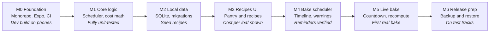

# Sourdough Assistant — Build Plan

Nov 26, 2026 · Chris

v1 is built in seven milestones, logic first: the scheduler and cost math are a tested TypeScript package before any screen uses them. Each milestone ends with something runnable on your phone.

## Roadmap



From M4 on, every milestone is tested by baking real bread with the app.

## Repo layout and conventions

[cboath/sourdoughAssistant](https://github.com/cboath/sourdoughAssistant) holds only a README today, so M0 sets it up as an npm-workspaces monorepo. The web app and AWS backend slot in later without moving anything.

```
sourdoughAssistant/
  apps/
    mobile/          Expo (React Native) app, expo-router, TypeScript
    web/             Phase 2: React web app (empty for now)
  packages/
    core/            Pure TypeScript: scheduler, units, baker's %, cost, sell price
  infra/             v1.1: AWS SAM template for sync (empty for now)
  .github/workflows/ CI: lint, typecheck, test
  package.json       npm workspaces root
```

| Convention | Choice |
| --- | --- |
| Language | TypeScript, `strict: true` everywhere |
| Lint and format | ESLint + Prettier, run in CI and on commit (lint-staged) |
| Core tests | Vitest in `packages/core`; no React Native imports allowed there |
| App tests | Jest + React Native Testing Library for key screens |
| Times | Stored as UTC ISO strings, shown in local time; `date-fns-tz` for zone math |
| Money | Integer cents in storage and math; format only at display |
| Weights | Grams in storage and math; other units convert at the edges |
| Branching | `main` always builds; one short-lived branch per milestone task |

## Milestones

Each milestone has a done-when test you can check on your own phone. M1 and M2 don't depend on each other and can run in either order.

### M0 — Foundation

- [ ] Convert the repo to npm workspaces: `apps/mobile`, `packages/core`, root scripts
- [ ] Scaffold the Expo app with expo-router and TypeScript; app name, bundle IDs (iOS and Android)
- [ ] Set up `packages/core` with Vitest and import it from the app
- [ ] Add ESLint, Prettier, lint-staged and a shared tsconfig
- [ ] GitHub Actions: lint, typecheck and test on every push
- [ ] EAS: development builds for iOS and Android

**Done when:** a dev build runs on your iPhone and an Android device, and CI is green.

### M1 — Core logic (`packages/core`)

- [ ] Units: weight and volume conversion, per-ingredient grams-per-cup, display in grams plus cups/oz
- [ ] Recipe math: baker's percentages, total hydration including levain, scaling by loaf count or dough weight
- [ ] Cost: package price to cost per gram, cost per line, batch and loaf (cents), suggested sell price from markup %
- [ ] Scheduler: backward pass from ready time; default and min-max per step; steps that run alongside (preheat); stretch-and-fold sub-reminders (count × interval); bulk starts after the last fold
- [ ] Kitchen-temperature adjustment of bulk and room-temperature proof, clamped to each step's range
- [ ] Quiet-hours check that returns warnings only
- [ ] Multi-recipe bakes: oven capacity, shared vs back-to-back bake slots, per-recipe offsets
- [ ] Forward "start now" mode and earliest-possible ready time when the requested one is too soon
- [ ] Live recompute: given actual start/end times, shift the remaining steps

**Done when:** tests pass for every PRD example: 77.3% hydration, $1.39 loaf, 3:05 AM Friday feeding for a 10 AM Saturday loaf, plus daylight-saving nights.

### M2 — Local data

- [ ] SQLite schema for Recipe, RecipeIngredient, PantryItem, PriceHistory, Step, Bake, BakeItem, Settings
- [ ] Migration runner with a version table, so later schema changes are safe
- [ ] Typed repositories (CRUD) on top of expo-sqlite
- [ ] Seed data on first launch: your default process as the starting recipe, plus 1 to 2 more and a starter pantry
- [ ] Settings: quiet hours, oven capacity, default markup %, heads-up minutes

**Done when:** repository tests cover create, edit, delete and reload for every entity.

### M3 — Recipes, pantry and cost UI

- [ ] Pantry list and editor: package price, size, unit, grams-per-cup; price history
- [ ] Recipe list with search, tags and favorites
- [ ] Recipe editor: ingredient lines from the pantry, roles, units
- [ ] Step editor: default duration and min-max range per step, fold count and interval, "runs alongside"
- [ ] Recipe detail: baker's %, hydration, scaling control
- [ ] Cost breakdown screen: per line, per batch, per loaf, suggested sell price

**Done when:** you can enter your own recipe and prices and see a cost per loaf you trust.

### M4 — Bake scheduler and reminders

- [ ] Schedule screen: pick one or more recipes, ready date and time, kitchen temperature
- [ ] Per-step sliders inside each range, with the default preselected
- [ ] Oven-capacity prompt for multi-recipe bakes
- [ ] Timeline view of every step's start time, with quiet-hours warnings inline
- [ ] Local notifications for each step, each fold, and an optional heads-up
- [ ] Android exact-alarm permission; reschedule pending notifications on launch and after updates
- [ ] Optional: add the schedule to the device calendar

**Done when:** a real bake is scheduled and every reminder fires on time with the app closed, on both phones.

### M5 — Live bake

- [ ] Active bake screen: current step, countdown, next step, mark done
- [ ] Recompute remaining steps when a step runs long or short; notifications update to match
- [ ] Several active bakes at once, listed on the home screen
- [ ] Keep-screen-awake toggle and large tap targets

**Done when:** you complete one full real bake on the app alone, no paper.

### M6 — Backup, polish and release prep

- [ ] Full backup to one JSON file through the share sheet; restore with a confirmation step
- [ ] Single-recipe export and import
- [ ] First-run onboarding: units, quiet hours, oven capacity
- [ ] Accessibility pass: dynamic type, screen reader labels, contrast
- [ ] App icon, splash screen, privacy policy (store-ready, no tracking)
- [ ] TestFlight and Google Play internal testing builds through EAS Submit

**Done when:** the app installs from TestFlight and Play internal testing, and a backup from one phone restores on the other.

## Testing and v1 release checklist

Most of the risk sits in `packages/core` and in notifications, so that's where testing effort goes.

| Layer | How it's tested | Bar |
| --- | --- | --- |
| Core logic | Vitest unit tests, table-driven from the PRD examples; fixed clock and time zone | Every function covered; DST spring-forward and fall-back nights included |
| Data | Repository tests against an in-memory SQLite | Each entity round-trips; migrations run from an empty DB |
| Screens | React Native Testing Library on the recipe editor, schedule screen and live bake | Key flows render and save |
| Notifications | Manual test script on both phones: app closed, phone locked, Android battery saver on | Every reminder within 1 minute |
| Real use | Bake with the app each milestone from M4 on | Bugs logged as GitHub issues |

**v1 release checklist**

- [ ] All M0 to M6 done-when tests pass
- [ ] Three real bakes completed on the app, including one multi-recipe bake and one overnight bake
- [ ] Backup made on one phone restores on the other
- [ ] No crashes in TestFlight and Play internal testing over one week
- [ ] Privacy policy published; app collects nothing off the device
