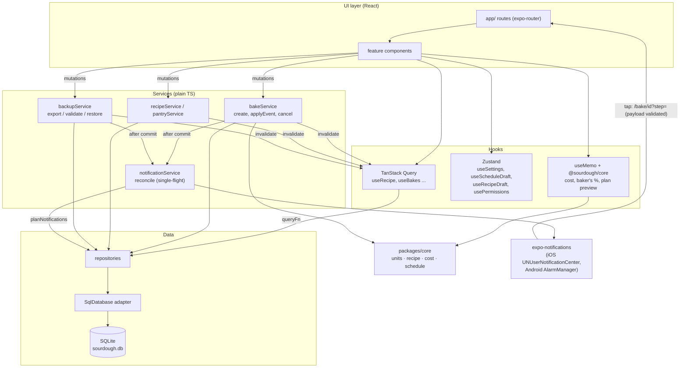
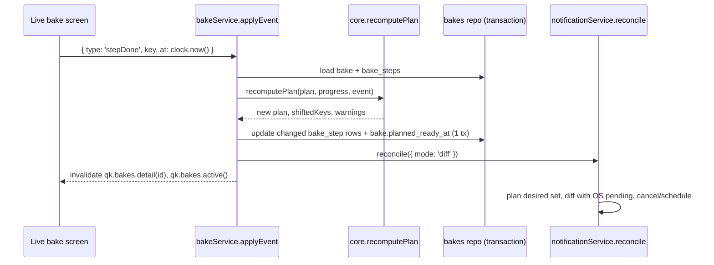

# Sourdough Assistant: mobile architecture (v1)

2026-11-26 · mobile-solutions-architect (AR-01) · Inputs: `docs/PRD.md`, `docs/BUILD_PLAN.md`, `docs/plan.md` (A1 to A9), `docs/design/flows.md` (DS-01), `docs/test-cases/core-cases.md` (QA-01 ambiguity ledger)

Companion docs: `docs/data-model.md` (SQLite schema), `docs/core-api.md` (`packages/core` contract), and `docs/adr/0001` to `0015`.

Items marked **PROVISIONAL** depend on an open question for Chris (plan section 6). The default is chosen and work proceeds; changing it later is a data or config change unless noted.

---

## 1. Summary

| Concern | Decision | ADR |
|---|---|---|
| Framework | Expo SDK 58 (RN 0.88, React 19.3, New Architecture, Hermes), TypeScript strict, dev builds (no Expo Go), CNG | 0001 |
| Min OS | iOS 18.0; Android minSdk 31, targetSdk 36, compileSdk 37 (**PROVISIONAL**, Q10) | 0001 |
| Navigation | expo-router, 4 tabs plus root-level modals; deep links limited to an allowlist through `+native-intent.tsx`; scheme `com.cboath.sourdoughassistant` (section 4) | here |
| State | TanStack Query over local repositories; Zustand for settings, drafts and permission status | 0002 |
| Storage | expo-sqlite, plain SQL, typed repositories, forward-only migrations, STRICT tables | 0003 |
| Sync readiness | UUIDs, UTC `created/updated/deleted_at`, soft deletes everywhere | 0004 |
| Time | Elapsed-minute durations, UTC instants, local display in the current zone | 0005 |
| Money | Integer minor units; round half up once per line; markup in basis points | 0006 |
| Levain | One line, hydration %, flour pantry item; water part free | 0007 |
| Temperature | Multiplier table at a 24 °C reference, 5-min rounding, clamped (**PROVISIONAL**, Q7) | 0008 |
| Multi-recipe | Greedy oven slots; last slot cools at the ready time; no reheat gap (**PROVISIONAL**, Q8) | 0009 |
| Scheduler rules | Alongside alignment, folds, quiet hours, too soon, live recompute (pure shift) | 0010 |
| Notifications | Deterministic ids, single-flight idempotent reconcile, iOS budget 60 plus a sentinel, Android `alarmClock` delivery | 0011 |
| Backup | Versioned JSON, Zod-validated, all-or-nothing replace, safety export | 0012 |
| DB tests | Jest `db` project on `node:sqlite` in memory through an adapter interface | 0013 |
| Bakes | Recipe and cost snapshots, materialized `bake_step` plan | 0014 |
| Privacy and ops | No analytics or crash SDK; local diagnostics; compile-time flags; unencrypted SQLite accepted; OS backups on, with exclusions; **OTA (`expo-updates`) OPEN for Chris, building without it in the meantime** | 0015 |

## 2. Shared assumptions with `cloud-infrastructure-architect`

v1 has **no network API** (plan section 2). These are recorded for CL-01 and v1.1:

1. **API style for v1.1 sync:** REST on API Gateway HTTP API + Lambda (the default stack), using `POST /sync/push` and `GET /sync/pull?since=`. Records are whole-row upserts keyed by client-generated UUIDs. This is not GraphQL or AppSync: the data is small and per-user, and that endpoint shape is simple to test offline.
2. **Conflict rule:** last writer wins per record by `updated_at`. Bake-step actuals win over plan changes. Tombstones propagate. (ADR 0004.)
3. **Auth (v1.1):** Cognito through Amplify Auth or a thin client, with the refresh token in `expo-secure-store`. Nothing in v1.
4. **Push:** not needed in v1 or v1.1. All reminders are local notifications computed on the device. No APNs or FCM keys, no SNS.
5. **DynamoDB mapping:** `docs/data-model.md` section 4 (CL-01 confirms embedded vs separate child items).

## 3. Layers and data flow

```
UI (app/ routes, src/features/*/components, src/ui)
  ↓ props / hooks only
Hooks (src/features/*/hooks): TanStack Query + Zustand selectors + core computations (useMemo)
  ↓
Services (src/features/*/services): orchestrate writes, transactions, query invalidation, notification reconcile
  ↓                                   ↘
Repositories (src/db/repositories) → SqlDatabase adapter → expo-sqlite       packages/core (pure TS math, scheduler)
Platform adapters (src/features/notifications/service.ts, src/lib/*) → expo-notifications, expo-sharing, ...
```

Rules:
- **Components never import repositories, expo-sqlite or expo-notifications.** Only hooks and services do.
- **Domain logic lives in `packages/core`**: pure functions, tested with Vitest. App-side pure logic (the notification planner, backup schemas and upgraders, the text recipe parser) lives in plain `.ts` files with Jest tests and no React imports.
- Services are plain TS modules that take dependencies explicitly (`{ db, clock, ids, notifier, queryClient }`), so they can be tested without React.



### Typical write: "mark step done"



## 4. Route map (expo-router), final

This adopts the DS-01 proposal (`docs/design/flows.md` section 1.4) with small path fixes. **It changes some output paths in `docs/plan.md`** (see section 18).

```
apps/mobile/app/
  _layout.tsx                      Root Stack. Providers (QueryClient, theme, SafeArea), DB gate + splash,
                                   onboarding redirect, notification-response deep links, ErrorBoundary
  index.tsx                        <Redirect> to /onboarding (if not completed) or /bakes
  +native-intent.tsx               redirectSystemPath: deep-link allowlist (SEC-01 M2, see below)
  +not-found.tsx
  onboarding/
    _layout.tsx                    Stack, no back to tabs
    index.tsx                      Welcome + units (metric/US, °C/°F)
    quiet-hours.tsx
    oven.tsx                       Oven capacity
                                   (no notifications step: permission is primed at the first "Schedule bake"
                                    via bake/schedule/permission-*.tsx, DS-04. Step 1 offers "Restore a backup")
  (tabs)/
    _layout.tsx                    Tabs (backBehavior="firstRoute"): Bakes · Recipes · Pantry · Settings
    bakes/_layout.tsx, index.tsx   BAKES-HOME: active + upcoming bakes, banners, "Schedule a bake"
    recipes/_layout.tsx            Stack
    recipes/index.tsx              RECIPE-LIST (search, tags, favorites)
    recipes/[id]/index.tsx         RECIPE-DETAIL (baker's %, hydration, scaling) ?loaves=<int 1..50> (view-only scale)
    recipes/[id]/cost.tsx          COST-BREAKDOWN ?loaves=<int 1..50>
    pantry/_layout.tsx, index.tsx  PANTRY-LIST
    pantry/[id].tsx                PANTRY-DETAIL + price history
    settings/_layout.tsx, index.tsx
    settings/quiet-hours.tsx, oven.tsx, units.tsx, cost.tsx (markup, rounding),
    settings/reminders.tsx         (heads-up minutes, permission status, battery guide)
    settings/backup.tsx            (export, restore, undo last restore)
    settings/about.tsx             (version, privacy, share diagnostics)
  bake/
    schedule/_layout.tsx           Modal Stack (iOS pageSheet / Android full screen);
                                   unstable_settings = { initialRouteName: 'index' } so back from plan reaches the picker
    schedule/index.tsx             SCHED-PICK: recipes + loaves
    schedule/plan.tsx              SCHED-PLAN: ready time, oven capacity, kitchen temp, sliders, timeline, warnings
                                   ?recipeId=<uuid>&loaves=<int 1..50> (prefill only; "Schedule this recipe")
    schedule/permission-notifications.tsx   PERM-NOTIF  ?bakeId=<uuid> (the bake is ALREADY saved, DS-03)
    schedule/permission-alarm.tsx           PERM-ALARM (Android only) ?bakeId=<uuid>
    [id]/_layout.tsx               presentation: 'fullScreenModal' (over tabs)
    [id]/index.tsx                 BAKE-LIVE (?step=<bakeStepId> to focus a step)
    [id]/timeline.tsx              Full timeline of the bake
  recipe-editor/
    _layout.tsx                    Modal Stack; owns useRecipeDraft (Zustand) lifetime
    [id].tsx                       RECIPE-EDIT ('new' or a uuid; ?duplicateOf=<uuid>)
    ingredient.tsx                 INGR-EDIT (?lineId=<uuid> to edit; new line: ?pantryItemId=<uuid> and/or ?role=levain)
    step.tsx                       STEP-EDIT (?stepId=<uuid>)
  pantry-editor/
    _layout.tsx                    Modal Stack
    [id].tsx                       PANTRY-EDIT ('new' or a uuid; ?returnTo=ingredient; ?name=<prefill, ≤200 chars>)
  import.tsx                       IMPORT-PREVIEW (modal): recipe JSON/text or backup file; takes NO params.
                                   The picker runs BEFORE the modal opens; the file is handed over only through the
                                   in-memory `useImportSession` store (src/features/backup/store.ts), never a route param
```

- **Sheets, not routes:** `INGR-PICK` (pantry picker), `PRICE-UPDATE`, `UnitPicker` and the other pickers are component sheets owned by their screen, so they're not deep-linkable (DS-02 Q-A2).
- **Route-param rules** (SEC-01 M2):
  1. Each screen parses its params with a Zod schema in `src/lib/route-params.ts`: `z.uuid()`, `'new'` where allowed, `z.enum` for `role` and `returnTo`, int ranges for `loaves`, and `name` capped at 200 characters and cleaned. Invalid params or an unknown id send the user to `+not-found`.
  2. **No screen changes data on mount because of a param.** Params may only preselect, prefill or focus something. Writes happen only on an explicit user action.

- `bake/schedule` is a static segment, so it takes precedence over `bake/[id]`.
- **Deep links:** the scheme is **`com.cboath.sourdoughassistant`** (RE-01 set it in `app.config.ts`, per SEC-01 M2). The bundle id is unique, so no other app claims the same scheme. `app/+native-intent.tsx` (`redirectSystemPath`) **allows only** `/` and `/bake/<uuid>` with an optional `?step=<uuid>`. Every other incoming path is rewritten to `/`.
  - A notification tap opens `/bake/<bakeId>?step=<bakeStepId>` over the current tab, after the payload check (ADR 0011 section 4). On a cold start, the Bakes tab sits underneath, so back returns to BAKES-HOME.
  - In-app `router.push` calls aren't affected by the allowlist.
- **Typed routes** are on (`experiments.typedRoutes`). Route params are validated with small Zod schemas in each screen.
- Editors spread across several routes share one draft through `useRecipeDraft` (Zustand, created and reset by `recipe-editor/_layout.tsx`). React Hook Form + Zod handle each screen's form, and Save commits the whole aggregate in one transaction.

## 5. State

See ADR 0002. Query keys are in `src/state/query-keys.ts`:

```ts
export const qk = {
  recipes: { all: ['recipes'] as const, list: (f: RecipeFilter) => ['recipes', 'list', f] as const, detail: (id: string) => ['recipes', 'detail', id] as const },
  pantry:  { all: ['pantry'] as const, list: () => ['pantry', 'list'] as const, detail: (id: string) => ['pantry', 'detail', id] as const,
             history: (id: string) => ['pantry', 'history', id] as const },
  bakes:   { all: ['bakes'] as const, active: () => ['bakes', 'active'] as const, detail: (id: string) => ['bakes', 'detail', id] as const },
};
```

| Write | Invalidates |
|---|---|
| Pantry create, edit, price change, archive | `pantry.all`, `recipes.all` (costs are computed from both) |
| Recipe create, edit, duplicate, delete, favorite | `recipes.all` |
| Bake create, event, cancel, complete | `bakes.all` |
| Restore | everything (`queryClient.clear()`, then refetch) and settings re-hydration |

- **Costs are not a separate query.** `useRecipeCost(id)` combines `recipes.detail` and `pantry.list({ includeArchived: true })` and calls `core.costBreakdown` in a `useMemo`. Archived items still price their lines (DS-02 Q-A5).
- **Zustand stores:**
  - `src/state/settings.ts`: `useSettings` (RN-03), hydrated before first render, with write-through `update(patch)`.
  - `src/features/schedule/store.ts`: `useScheduleDraft`.
  - `src/features/recipes/store.ts`: `useRecipeDraft`.
  - `src/features/notifications/store.ts`: `usePermissions`.
  - `src/features/backup/store.ts`: `useImportSession`, an in-memory handoff of the picked file (cache URI, size, intent) from the picker to `app/import.tsx`. It's cleared when the modal closes and never persisted.
- **Clock:** `useNow(intervalMs)` (`src/lib/clock.ts`) is used only on the live view (1 s) and Bakes home (30 s). There is no global ticking store.

## 6. Folder layout (scaffold-ready)

The BUILD_PLAN repo layout is unchanged. Inside `apps/mobile`:

```
apps/mobile/
  app/                         routes (section 4)
  src/
    db/
      adapter.ts               SqlDatabase / SqlExecutor interfaces (ADR 0013)
      deps.ts                  Clock / Ids interfaces (injected into repositories)
      adapters/expo.ts         expo-sqlite implementation (one connection, BEGIN IMMEDIATE, queue for all calls during a tx)
      adapters/node.ts         node:sqlite implementation (tests only)
      client.ts                open + PRAGMAs + migrate + seed; exports getDb()
      migrate.ts               runner, safety copy, downgrade guard
      migrations/index.ts      registry
      migrations/0001_init.ts  DDL from docs/data-model.md §2
      mappers/*.ts             row <-> domain (incl. bakePlan.ts)
      repositories/{settings,pantry,recipes,bakes,meta}.ts
      seed/{index,recipes,pantry}.ts
      types.ts                 domain types
      test-utils.ts            createTestDb()
    features/
      pantry/{components,hooks,services,schema.ts}
      recipes/{components,hooks,services,store.ts,schema.ts}
      cost/{components,hooks}
      schedule/{components,hooks,services,store.ts}
      live/{components,hooks}
      notifications/{planner.ts,service.ts,channels.ts,permissions.ts,store.ts,hooks}
      backup/{export.ts,import.ts,schema.ts,upgrade.ts,text.ts,components}
      onboarding/{components}
      settings/{components}
    state/
      query-client.ts, query-keys.ts, settings.ts
    ui/
      theme/tokens.ts          ← DS-01 docs/design/tokens.md TS block (confirmed location)
      theme/{index.ts,useTheme.ts}
      components/              base components from docs/design/components.md
    lib/
      clock.ts, ids.ts         system implementations + useNow; the Clock/Ids INTERFACES live in src/db/deps.ts (RN-02)
      route-params.ts          Zod schemas for every screen's params (SEC-01 M2)
      logger.ts, flags.ts, errors.ts, locale.ts (currency, units defaults), platform.ts
  plugins/                     config plugins (only if AN-01/IO-01 need them)
  modules/                     local Expo modules (none planned for v1)
  assets/
  app.config.ts, eas.json, jest.config.js
```

```
packages/core/
  src/
    types.ts
    units/{index,convert,format}.ts
    recipe/{index,levain,bakersPercent,scale}.ts
    cost/{index,line,breakdown,sellPrice,money}.ts
    schedule/{index,validate,durations,temperature,backward,quiet,time,multi,recompute}.ts
    index.ts                   barrel (CO-03)
  test/acceptance/*.test.ts    QA-02
```

## 7. Local data

See `docs/data-model.md`, and ADRs 0003, 0004 and 0014. Key points:
- One SQLite file. Migrations run on startup before first render. A safety copy of the DB is made before migrating an existing database, and a downgrade guard stops an older app from opening a newer DB.
- Soft deletes everywhere. Restore is the only hard delete.
- Bakes hold recipe and cost snapshots and a materialized `bake_step` plan with original, planned and actual times.

### 7.1 Pantry, recipe and seed rules (DS-02 section 12.2, Q-A1 to Q-A7)

| Q | Decision |
|---|---|
| Q-A1 small amounts | **Already satisfied by core.** `formatAmount` shows whole grams from 10 g up, and below 10 g it shows 1 dp only when the value isn't whole (2.5 g as "2.5 g", 3 g as "3 g"). That's now written in `docs/core-api.md` section 2. **No API change.** Stored grams stay REAL, so saved recipes keep 2.5 g. **Scaling still rounds to whole grams** (R-4, ADR 0010 section 8), so a *scaled* 2.5 g line shows 3 g. That's accepted for v1. A sub-10 g scaling precision would be a later, additive `ScaleOptions` field. |
| Q-A2 route params | Added to section 4. `INGR-PICK` and `PRICE-UPDATE` are sheets, not routes. |
| Q-A3 bake scaling | **v1 bakes scale by loaves only.** `bake_item.loaves` and `scale_factor = loaves / snapshot.yieldLoaves`. The snapshot lines are scaled with `scaleLines({ by: 'loaves' })`. DS-03 shows "Uses the recipe's dough weight". A per-bake dough-weight target can be added in v1.1 with an additive column (`target_dough_weight_g`). Because `scale_factor` is already a general REAL, no rewrite would be needed. |
| Q-A4 price history | Confirmed; the methods are listed below. |
| Q-A5 archived items | Repositories default to `deleted_at IS NULL`, but `pantry.list({ includeArchived: true })` and `pantry.getByIds(ids, { includeArchived: true })` return archived items for costing, labels and "Used in". "Used in" = live recipes with a live ingredient line pointing at the item, whether or not the item is archived. **Restore path in v1:** only the 8 s undo, which calls `pantryService.unarchive(id)` (clears `deleted_at`, bumps `updated_at`). There's no archived-items browser in v1. |
| Q-A6 "Add starter recipes" | **Keep the button**, shown only when the live recipe list is empty. It calls `seedService.addStarterRecipes()`, which inserts **fresh copies** (new UUIDs, `seed_key = NULL`) of the seed recipes. Pantry items are matched by live `seed_key`, then by case-insensitive name. Missing ones are created with `seed_key = NULL`. The automatic first-launch seed still never recreates tombstoned seed rows (data-model section 5). Tombstones are never revived. |
| Q-A7 entry unit after a density change | Confirmed: **stored grams always win.** `INGR-EDIT` shows the entered amount and unit only if `toGrams(entryAmount, entryUnit, currentFactors)` is within 0.5 g of `amountG`. Otherwise it shows grams, and the next save clears `entry_amount` and `entry_unit`. Cost and baker's % never depend on the entered unit. |

**`pantryService` (RN-05):**

```ts
createItem(input): Promise<PantryItem>                       // the initial price (if any) also appends price_history
updateItem(id, patch): Promise<PantryItem>                   // non-price fields only (price is read-only in edit mode)
savePrice(itemId, { packagePriceCents, packageSize, packageUnit, store, pricedAt }): Promise<void>
  // 1 tx: append price_history; mirror to pantry_item ONLY IF pricedAt >= current priced_at (same date: the newer entry wins)
deletePrice(historyId): Promise<void>
  // 1 tx: refuse if it's the item's last live history row; soft-delete; re-mirror the latest live row (priced_at DESC, created_at DESC)
restorePrice(historyId): Promise<void>                        // undo of deletePrice; clears deleted_at, re-mirrors
archive(id): Promise<void>; unarchive(id): Promise<void>      // soft delete + undo
```

Every method invalidates `pantry.all` and `recipes.all`.

## 8. Domain rules (summary; details in the ADRs and core-api)

- **Time (ADR 0005):** elapsed minutes; UTC storage; display and quiet hours in the current device zone. Gap times move forward and repeated times take the first occurrence.
- **Money (ADR 0006):** minor units. `lineCents = roundHalfUp(price × grams / packageGrams)`. Batch = sum of rounded lines. Per loaf = roundHalfUp(batch / loaves). Sell price comes from the unrounded per-loaf cost, as a markup in basis points.
- **Levain (ADR 0007):** split by hydration. The flour part is billed at the pantry flour price and the water is free. Baker's % uses total flour including levain flour.
- **Scaling (ADR 0010 section 8):** whole grams, half up. A non-zero amount becomes at least 1 g. The dough-weight target is per loaf.
- **Temperature (ADR 0008, PROVISIONAL):** a 1.09^(24−T) table, applied only to `tempSensitive` steps, rounded to 5 min and clamped. Sliders override it.
- **Scheduler (ADR 0010):** backward or forward chain; alongside `endsAtStart`/`startsAtStart`/`endsAtEnd`; fold i at start + (i−1)·interval; quiet-hours window `[start, end)` for step starts and folds; too-soon gives the earliest time at the chosen durations; live recompute is a pure shift with explicit "Hold ready time" and "+15 min" actions.
- **Oven slots (ADR 0009, PROVISIONAL):** greedy fill in item order, the last slot cools at the ready time, slots back to back, one merged preheat.

## 9. Notifications

See ADR 0011. Summary for RN-07, AN-01 and IO-01:

| Item | iOS | Android |
|---|---|---|
| Permission | `requestPermissionsAsync({ ios: { allowAlert, allowSound } })` after the primer | `POST_NOTIFICATIONS` runtime (API 33+), after channels exist, then the `SCHEDULE_EXACT_ALARM` explainer → `requestExactAlarmPermissionsAsync()` |
| Delivery | `DATE` trigger; `interruptionLevel: 'timeSensitive'` for start and fold, `'active'` for heads-up | `DATE` trigger; `delivery: 'alarmClock'` for start and fold, `'bestEffort'` for heads-up; channels `bake-steps-v1` (HIGH), `bake-headsup-v1`, `general-v1` |
| Budget | 60 pending (cap 64); critical first, then heads-ups before the horizon, plus a top-up sentinel | 150 |
| Grouping | `threadIdentifier = bakeId` | same (group key) |
| Reboot | OS keeps the pending ones | `RECEIVE_BOOT_COMPLETED` (expo re-arms), plus a rebuild on the next launch |
| Identity | `sa1:<bakeId>:<stepKey>:<kind>[:n]` + `data.hash` | same |

- **Reconcile:** `rebuild` on cold start, restore, permission change and zone change. `diff` on foreground and after every bake write. Single flight.
- **Order (DS-03):** the bake is **saved first**, then the permission primers are shown if needed. Save runs a `diff` reconcile, which schedules immediately if permission is already granted. A grant in the primer triggers a `rebuild`. Leaving the primer never loses the bake. This replaces the `flows.md` §5.2 order.
- **Payload:** `{ v, bakeId, bakeStepId, stepKey, kind, foldIndex?, fireAt, hash }`. A tap goes to `/bake/<bakeId>?step=<bakeStepId>`.
- **No notification action buttons in v1** (this confirms DS-01).
- **"Fold N done" reschedules the remaining fold reminders** (core `foldDone` event, ADR 0010 section 7).
- **Degraded banners:** notifications denied, exact alarm denied, battery optimization on. The app still works in all of them.

## 9.1 Bake lifecycle and live-view service rules (DS-03 section 12.2)

| Q | Decision |
|---|---|
| Q-A1 params | Added to section 4. `initialRouteName: 'index'` is confirmed. |
| Q-A2 undo | `bakeService.applyEvent(bakeId, event)` returns `{ revertToken }`. The token holds the **pre-image** of every `bake` and `bake_step` row the event changed, plus the bake's post-event `updated_at`. It lives in memory only. `bakeService.revert(token)` restores the pre-image in **one transaction** only if the bake's `updated_at` still equals the post-event value, so **only the latest event can be reverted**. Any later write makes the token stale, and `revert` returns `{ ok: false, reason: 'stale' }`. Then it runs a `diff` reconcile. The UI drops the token after 8 s. There are no inverse events in core. |
| Q-A3 past times | Confirmed. `stepDone.at` and `stepStarted.at` may be in the past. **Bounds are checked in `bakeService`, not core:** `stepDone.at` must be ≥ the step's actual start (or planned start if it never started) and ≤ now. `stepStarted.at` must be ≤ now and ≥ the actual end of the previous done sequential step, if any. Out-of-bounds input returns a typed `UserFacingError`. Core accepts any `at`. Done steps stay read-only in v1. |
| Q-A4 auto-activation | **Bake level: written by the service.** `bakeService.sweep(now)` runs on launch, on foreground and after reconcile. It moves `scheduled → active` when `now ≥` the first planned start (`started_at` = that planned start) and auto-completes stale bakes (Q-A10). **Step level: derived in the UI only.** No automatic `stepStarted` is written, and a step stays `pending` until the user acts. The UI shows the "current" step from planned times (DS-03 §8.1 rule 2). Alongside steps whose anchor has started are **left unmarked** ("Not marked done"), never inferred. |
| Q-A6 overlap | Derived in the app: a pure TS helper at `src/features/schedule/overlap.ts` (10-minute window, different items, same-slot oven steps excluded), with Jest tests. No core warning code. |
| Q-A7 budget dry run | `planNotifications` is dry-run (iOS only) **when the plan screen opens, whenever items or loaves change, and once more on Confirm**. It doesn't run on slider or time changes, because the count barely moves. |
| Q-A10 stale bakes | Accepted. `sweep` sets `status = 'completed'` and `completed_at = planned_ready_at` for active or scheduled bakes whose `planned_ready_at` is more than 12 h in the past. Step rows are left as they are, there's no snackbar, and a `diff` reconcile follows. |
| Q-A11 keep-awake | Confirmed. The live-view toggle calls `useSettings.update({ keepAwakeDefault })` (write-through), and the same value is the switch on the Settings root. |

**Data-layer needs (RN-06/RN-08 scope):** the bakes repo exposes `snapshotRows(bakeId, stepIds)` and `restoreRows(preImage)`, which are used only by revert. `sweep` uses the existing status and time columns, so there's **no schema change**.

## 10. Backup and import/export

See ADR 0012. A versioned JSON envelope (`format`, `formatVersion`, `dbSchemaVersion`, counts, checksum) holds flat camelCase tables. Restore pipeline:
1. Size checked after copying to cache: 10 MB for a backup, 1 MB for a recipe JSON, 64 KB for text. An unknown size is rejected.
2. Parse.
3. Version check, then upgraders.
4. Zod strict validation.
5. Referential checks.
6. Confirm.
7. Safety export.
8. Replace everything in one transaction.
9. Invalidate, then a notification rebuild.

Single-recipe JSON and plain text (our own grammar only). Import creates new ids and matches pantry items by name.

## 11. Native capabilities, permissions and dependencies

| Capability | Module | iOS (Info.plist / entitlements) | Android (manifest) | Notes |
|---|---|---|---|---|
| Local notifications | `expo-notifications` | Entitlement `com.apple.developer.usernotifications.time-sensitive` (IO-01). No usage string. **Remove `aps-environment`** if the plugin adds it (no push; free personal teams can't sign it). IO-01 verifies | `POST_NOTIFICATIONS`, `SCHEDULE_EXACT_ALARM`, `RECEIVE_BOOT_COMPLETED` (auto), `VIBRATE` (auto). **Not** `USE_EXACT_ALARM` | ADR 0011 |
| Battery-optimization check | `expo-battery` (`isBatteryOptimizationEnabledAsync`) | none | none (we do **not** declare `REQUEST_IGNORE_BATTERY_OPTIMIZATIONS`; we open settings with an intent instead) | Android only |
| Keep screen awake | `expo-keep-awake` | none | none (uses `FLAG_KEEP_SCREEN_ON`) | live view toggle |
| Export (share sheet) | `expo-sharing`, `expo-file-system` | none | none (FileProvider set up by the module) | |
| Import (file picker) | `expo-document-picker` | none (no iCloud container; `usesIcloudStorage` off) | none (SAF) | |
| Locale, currency, zone | `expo-localization` | none | none | |
| Hashing, UUIDs | `expo-crypto` | none | none | |
| OTA updates | `expo-updates`: **OPEN (H1). Not included until Chris decides** | under (b): App Privacy "Device ID" + `PrivacyInfo.xcprivacy` entry | under (a): `INTERNET` blocked in `preview` and `production`; under (b): `INTERNET` + Data safety "Device or other IDs" | ADR 0015 section 5 |
| Calendar (S-10, Could) | `expo-calendar` (only if shipped) | `NSCalendarsWriteOnlyAccessUsageDescription`: "Sourdough Assistant adds your bake steps to the calendar you choose." | `READ_CALENDAR`, `WRITE_CALENDAR` | off by default (`flags.calendarExport`) |

**Not used in v1** (so no permissions for them): camera, photos, location, microphone, contacts, biometrics, background fetch/tasks, push, Bluetooth, critical alerts.

**Android blocked permissions** (AN-02 sets these in `android.blockedPermissions`): `READ_EXTERNAL_STORAGE`, `WRITE_EXTERNAL_STORAGE`, `SYSTEM_ALERT_WINDOW`, `USE_EXACT_ALARM`, `REQUEST_IGNORE_BATTERY_OPTIMIZATIONS`, `READ_MEDIA_*`, `com.google.android.gms.permission.AD_ID`. Also `INTERNET` in the `preview` and `production` profiles if H1 option (a) is chosen.

**Android backup rules** (AN-02, ADR 0015 section 6): leave out `SQLite/backups/`, `backups/` and `diagnostics.log`.

**iOS privacy manifest** (IO-02): aggregate the required-reason APIs from the Expo modules (UserDefaults CA92.1, file timestamp C617.1, system boot time 35F9.1, disk space E174.1 as applicable).
- Data collection: none under H1 option (a). Under (b), Device ID (app functionality, not linked, not tracking).
- `ITSAppUsesNonExemptEncryption = false`.
- Don't set `UIFileSharingEnabled` or `LSSupportsOpeningDocumentsInPlace`.

**Runtime dependencies (apps/mobile):**
- expo, expo-router, react-native-screens, react-native-safe-area-context
- expo-sqlite, expo-notifications, expo-localization, expo-keep-awake, expo-sharing, expo-file-system, expo-document-picker, expo-crypto, expo-battery, expo-splash-screen, expo-dev-client (`development` profile only), expo-build-properties (config); `expo-updates` only if H1 option (b) is chosen
- @tanstack/react-query, zustand, react-hook-form, @hookform/resolvers, zod
- @shopify/flash-list
- @sourdough/core

**packages/core:** date-fns, date-fns-tz.

Any new dependency is checked for network calls (ADR 0015).

## 12. Startup sequence and performance budget

1. `SplashScreen.preventAutoHideAsync()`.
2. `openDb()`: PRAGMAs, then `migrate()` (with the safety copy if migrations are pending), then `seed()`. **Budget: 250 ms** on a mid-range Android.
3. Hydrate `useSettings`. On the first run, the defaults come from the locale (unit system, °C/°F, currency).
4. Register the notification handler and the Android channels (idempotent).
5. Render the first route, then `SplashScreen.hideAsync()`.
6. After the first frame (`InteractionManager.runAfterInteractions`): `usePermissions.refresh()`, a zone-change check (`app_meta.lastTimeZone`), and `reconcileNotifications({ mode: 'rebuild' })`.

| Budget | Target | How it's checked |
|---|---|---|
| Cold start to interactive | < 2 s on a mid-range Android (Pixel 6a / Galaxy A5x class), release build | manual timing in QA-06; `adb shell am start -W` |
| List scrolling | 60 fps; recipes, pantry, timeline and price history use FlashList | Perf Monitor on Chris's Android in M3/M5 |
| Schedule preview recompute | < 16 ms per slider change (3 recipes) | Vitest micro-benchmark in core (informational) |
| JS bundle | tracked; alert on > 10% growth | CI step `npx expo export --platform android` recording the size (RE-01) |
| Live view | 1 Hz re-render of the countdown only (memoized subtree) | React Profiler spot check |

## 13. Error handling

| Layer | Strategy |
|---|---|
| Core | Domain failures are values (`Result`, `status` unions). Throwing is only for `CoreInvariantError` |
| Repositories | Throw `DbError { op, cause }` (`src/lib/errors.ts`). A transaction rolls back on any throw |
| Services | Catch `DbError`, log it, and rethrow a `UserFacingError { messageKey }` |
| Hooks/UI | Mutation `onError` shows a toast or snackbar ("Couldn't save. Try again."). Forms show Zod field errors inline |
| Routes | Every `_layout.tsx` exports an expo-router `ErrorBoundary` with "Try again" and "Share diagnostics" |
| Startup fatal | Migration failure or the downgrade guard leads to `FatalScreen`, with: retry, share diagnostics, and **"Save my data"**, so data is never trapped. "Save my data" runs `VACUUM INTO` a temporary file, or `PRAGMA wal_checkpoint(TRUNCATE)` first, so recent writes held in the `-wal` file aren't lost (SEC-01 L4c). It then shares that file through the share sheet and deletes it afterwards |
| Notifications | Never block the user flow. Scheduling failures are logged, and the reminders banner shows "Some reminders could not be scheduled", which triggers a retry on the next foreground |
| Import/restore | Typed validation errors, showing the first 3 in the preview. Nothing is written until confirmed (ADR 0012) |

## 14. Offline strategy

The app is offline by construction. Every feature reads and writes local SQLite, and all reminders are local. There are no retries, queues or optimistic-sync concerns in v1. Under H1 option (a), the app makes **no network calls at all**. Under (b), the only network call is the non-blocking `expo-updates` check. In v1.1, the sync engine plugs in at the service layer, with an outbox, push/pull, LWW, and query invalidation after a pull, without touching the UI.

## 15. Logging, analytics, feature flags

See ADR 0015:
- **Logging:** an in-memory ring-buffer logger, flushed to disk only on a crash boundary. The user shares it through Settings, About.
  - It never logs names, notes, file URIs or contents, or SQL params (SEC-01 L6).
  - `console.*` is stripped in release builds.
- **Analytics:** none, and no crash SDK.
- **Feature flags:** compile-time `src/lib/flags.ts`.
- **OTA: OPEN (SEC-01 H1).** Builds go without `expo-updates` until Chris picks (a) "drop it for v1" (recommended) or (b) "keep and declare". With (b), the setup is a fingerprint runtime, the `preview` channel, an `ON_LOAD` check, and no rollback across migrations.
- **Data at rest:** unencrypted SQLite, accepted (SEC-01 L1). OS backups stay on with exclusions (L2). Both are in ADR 0015.

## 16. Testing setup

| Layer | Tool | Location | Notes |
|---|---|---|---|
| Core | Vitest | `packages/core/src/**/*.test.ts`, `packages/core/test/acceptance` | explicit zones; `now` injected |
| DB | Jest project `db` (node env, `node:sqlite`) | `apps/mobile/src/db/**/*.test.ts` | `createTestDb()`; migration, round-trip and seed suites (ADR 0013) |
| App pure logic | Jest project `db` (node env) | `features/notifications/planner.test.ts`, `features/backup/*.test.ts` | the budget, ids, hash, upgraders, Zod, text grammar |
| Screens | Jest project `app` (jest-expo + RNTL) | `features/*/__tests__` | recipe editor, schedule, live bake |
| Notifications on device | manual script (QA-04) | `docs/test-scripts/notifications.md` | killed, locked, battery saver, reboot, update, DST, 3 and 5 bakes |

`apps/mobile/jest.config.js` (replacing the `jest` key in `apps/mobile/package.json`):

```js
module.exports = {
  projects: [
    { displayName: 'app', preset: 'jest-expo', testMatch: ['<rootDir>/src/**/__tests__/**/*.test.tsx', '<rootDir>/app/**/*.test.tsx'],
      transformIgnorePatterns: [/* keep RN-01's pattern, incl. @sourdough/.* */] },
    { displayName: 'db', testEnvironment: 'node',
      testMatch: ['<rootDir>/src/db/**/*.test.ts', '<rootDir>/src/features/notifications/*.test.ts', '<rootDir>/src/features/backup/*.test.ts'],
      transform: { '^.+\\.[jt]sx?$': ['babel-jest', { presets: ['babel-preset-expo'] }] },
      globalSetup: '<rootDir>/jest.global-setup.js' /* sets TZ=UTC */ },
  ],
};
```

## 17. Accessibility and platform conventions (architecture-relevant only)

- **Orientation:** portrait and landscape everywhere on phones and tablets (`orientation: 'default'` in `app.config.ts`, which RN-04 applies). A phone propped on the counter is a core use (DS-01 `flows.md` section 1.6), and DS-01 wins over the scaffold's `'portrait'`. There's no per-screen locking and no `expo-screen-orientation`. QA covers the live view and the schedule screen in landscape.
- Dynamic type is respected everywhere (no `allowFontScaling={false}`). Large tap targets (at least 56 pt/dp for "Mark done") come from DS-01 tokens.
- Every interactive base component in `src/ui/components` requires an `accessibilityLabel` prop (enforced by TS).
- Time formatting follows the locale's 12/24 h setting (`expo-localization` `uses24hourClock`).

## 18. Impact on other tasks (for the orchestrator)

| Task | Change |
|---|---|
| RN-01 | Already on SDK 58 and `@sourdough/core`; keep it. Add `.nvmrc` = 24. Move the Jest config into `jest.config.js` with two projects (or RN-02 does this). |
| RE-01 | CI Node 24. Record the bundle size. `expo-build-properties`: iOS 18.0, Android minSdk 31 (provisional). |
| RN-02 | Implement `docs/data-model.md` exactly. Adapter interface + `node:sqlite` test adapter. Safety copy + downgrade guard. Dev-only on-device self-test. |
| RN-03 | Seed uses `seed_key`, never recreates deleted seeds. Template from data-model section 5. Settings defaults: markup 20000 bps, heads-up 10, quiet 22:00 to 06:00, oven 1, reheat 0. |
| RN-04 | Tokens at `apps/mobile/src/ui/theme/tokens.ts` (confirmed). Route skeleton per section 4: **4 tabs including Settings**. |
| RN-05 | Output paths change: editors live in `app/recipe-editor/**` and `app/pantry-editor/**` (root modals), not under `(tabs)/`. |
| RN-06 / RN-08 | Live view at `app/bake/[id]/**` as a `fullScreenModal`. `bakeService.applyEvent` with the `stepStarted/stepDone/foldDone/extend` events. "Hold ready time" and "+15 min" actions. |
| RN-07 | ADR 0011 in full. |
| RN-10 | Output path changes: settings live in `app/(tabs)/settings/**`, not `app/settings/**`. |
| DS-03 | The last-fold button is "Fold 4 of 4 done" plus a secondary "Start bulk now". The live view shows the new ready time after early or late completion. Add "Hold ready time" and "+15 min". Add "clocks change tonight" and "Kitchen is cold: capped" copy. Add a "partial cost" state, "<1¢" lines, and "1001 g (target 1000 g)". |
| IO-01 | Time-sensitive entitlement. Check whether a free personal team can sign it. Strip `aps-environment` if it's added. |
| AN-01 | Verify that `delivery: 'alarmClock'` delivers on time under battery saver, after a reboot and after an update. Config plugin only if needed. |
| QA-01/02 | Use the AMB decisions in ADRs 0005 to 0010. Expected values that depend on Q7 or Q8 stay marked provisional. |
| SEC-01 | Done. Findings L1, L2, L3 and M2 to M4 are adopted in ADRs 0003, 0011, 0012 and 0015. H1 is open for Chris. |
| CL-01 | `docs/data-model.md` section 4, plus section 2 of this doc. `installId` survives an OS restore, so it isn't a unique device id (ADR 0015 section 6). |

**Follow-up batch (after DS-02, SEC-01 and RN-02 review):**

| Task | Change |
|---|---|
| RN-02 | Deviations accepted and recorded in ADR 0003 (single-connection `BEGIN IMMEDIATE`, runner-owned `_migrations`, `SQLite/backups/` path, `src/db/deps.ts`, settings `ensure()` revive). **Condition:** the adapter queues *every* outer-`db` call while a transaction is open, with a test for it. Add `pantry.list/getByIds({ includeArchived })`. |
| RN-04 | `app/+native-intent.tsx` allowlist, `src/lib/route-params.ts` Zod parsing, no param-driven writes on mount. Logger content rules and `console` stripping (ADR 0015 section 2). |
| RN-05 | Route params from section 4 (`?name=`, `?pantryItemId=`, `?role=levain`, `?loaves=`). `INGR-PICK` and `PRICE-UPDATE` are sheets. `pantryService` per section 7.1. "Add starter recipes" via `seedService.addStarterRecipes()`. |
| RN-06 | Bakes scale by loaves only (Q-A3). |
| RN-07 | Android channel lock-screen visibility is **PRIVATE**. Validate the payload before navigating. Cap and clean the text to 100 characters. Check exact-alarm permission before choosing `alarmClock`. |
| RN-09 | ADR 0012 caps: backup 10 MB, recipe 1 MB, text 64 KB, 500 lines, 500 characters per line. Size from `getInfoAsync` after copying. Strict, fully specified Zod. Sanitizing. Per-table row caps. Unique ids and anchor checks. The exporter self-validates. Counts on the confirm screen are computed from the data. |
| CO-02 / CO-03 | No signature change. `validateSteps` must not recurse, and plan functions must validate first (core-api section 5.1). |
| RE-01 | Scheme `com.cboath.sourdoughassistant` (done). Don't add `expo-updates`, `runtimeVersion` or channels while H1 is open. `npm audit` in CI. `expo-dev-client` in `development` only. |
| AN-02 / IO-02 | Backup-exclusion rules for `SQLite/backups/`, `backups/` and `diagnostics.log`. Block `AD_ID`. Privacy answers wait on H1. |
| DS-03 | "Uses the recipe's dough weight" (bakes scale by loaves only). |

**Follow-up batch (after DS-03 and DS-04):**

| Task | Change |
|---|---|
| **CO-03** | **Core change:** `PlannedStep.name` stays the plain template name, with no "(1 of 3 loaves: slot 2)" suffix (ADR 0009 §6, core-api §5.6). Update the affected tests. |
| RN-06 / RN-08 | `applyEvent` returns a `revertToken`; `revert(token)` works on the latest event only. Past-time bounds are checked in `bakeService`. `bakeService.sweep(now)` handles auto-activation and auto-completion after 12 h. Repo `snapshotRows`/`restoreRows`. `overlap.ts` and `labels.ts` helpers. Save the bake before the primers. Plan-screen params. Budget dry run on open, on item or loaf changes, and on confirm. The live view writes `keepAwakeDefault`. No schema change. |
| RN-07 | `ready` kind (non-critical tier, behind `flags.readyNotification`). `satest:` test reminder outside the `sa1:` namespace. Titles built from `stepLabel`. |
| RN-09 | The export self-check includes the 10 MB size cap. On restore: currency override (keep prices in their original currency + banner) and the `onboardingCompletedAt` fix-up. `app_meta.lastBackupExportedAt` / `lastRestoreSafetyAt`. `useImportSession` handoff. |
| RN-10 | Onboarding has 3 steps (no notifications step) and offers "Restore a backup". `src/lib/locale.ts` currency = `currency_override ?? device`. Settings, Cost shows the override read-only. |
| RN-04 | `orientation: 'default'` (landscape allowed). Logger never records money amounts. |

## 19. Provisional decisions waiting on Chris

| Q | Default used | Where |
|---|---|---|
| Q1/Q2 app name, bundle id | Scheme `com.cboath.sourdoughassistant` follows the proposed bundle id; if the bundle id changes, the scheme changes with it | section 4 |
| **H1 (SEC-01) OTA updates** | **OPEN.** (a) drop `expo-updates` for v1 (recommended) or (b) keep it and declare the Device ID. Building as (a) until Chris decides | ADR 0015 section 5 |
| Q6 seed content | Generic formulas (R-HYD amounts) + illustrative prices | data-model section 5 |
| Q7 temperature table, °C/°F | ADR 0008 table; unit from locale | ADR 0008 |
| Q8 slot target, reheat gap | Last slot cools at the ready time; gap 0 (setting) | ADR 0009 |
| Q10 devices | iOS 18.0 / Android API 31 | ADR 0001 |
| (existing calculator) markup default | 200% markup on cost, no rounding | ADR 0006 |
