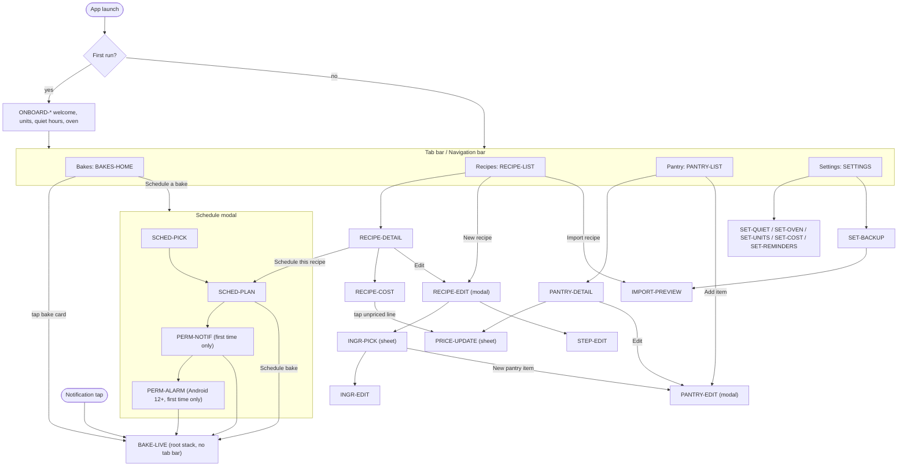
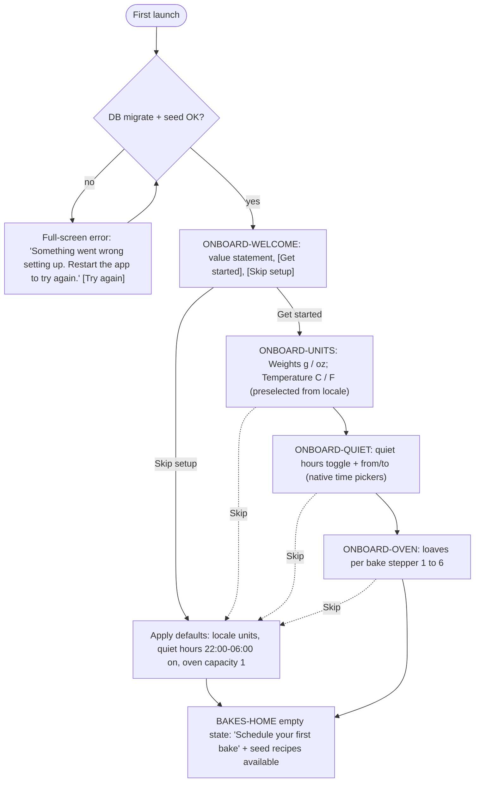
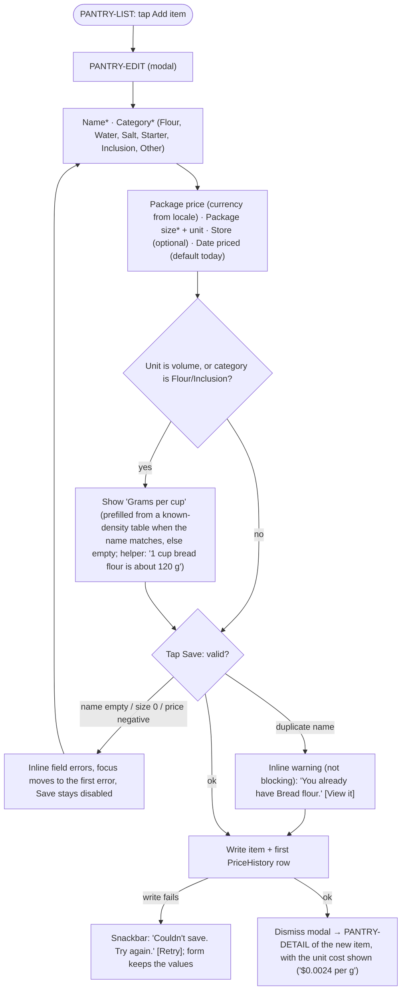
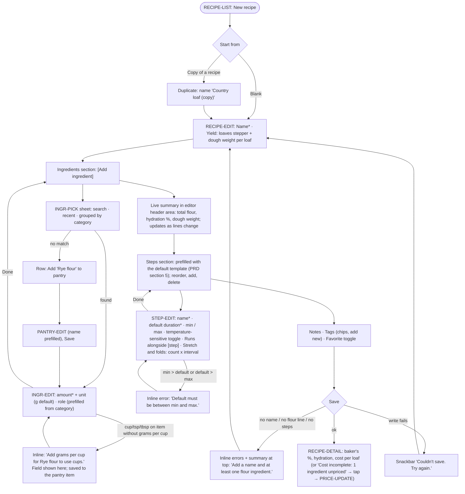
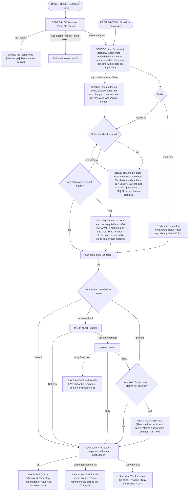
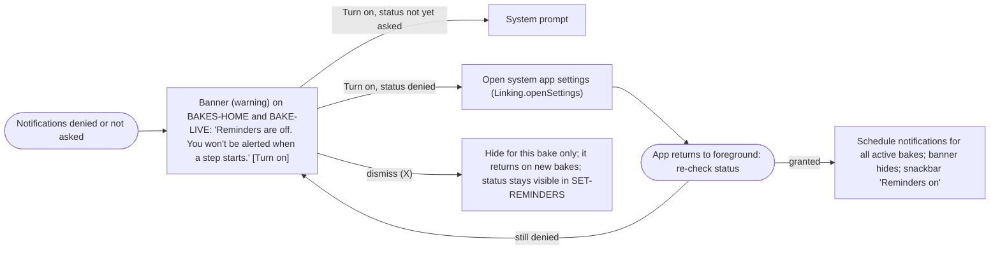
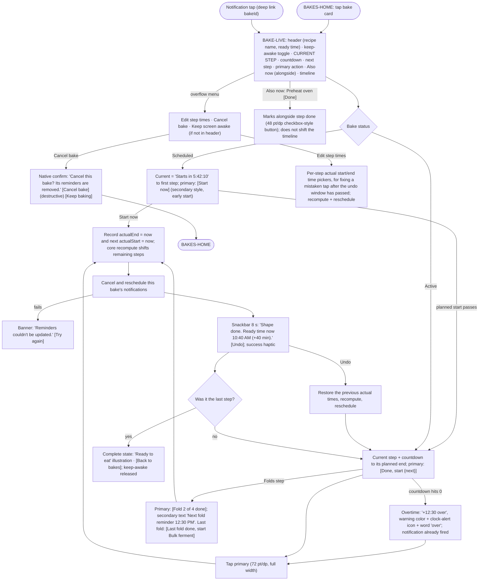
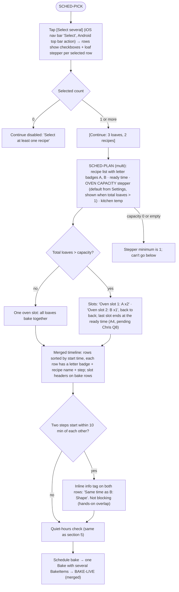
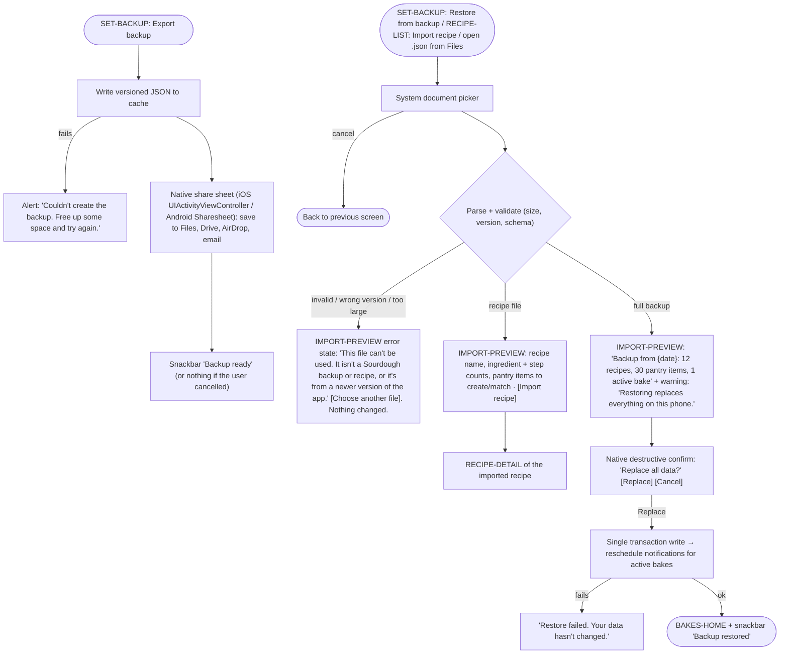

# Sourdough Assistant: information architecture and core flows

DS-01 · 2026-11-26 · ux-ui-designer · Inputs: `docs/PRD.md` (sections 2, 4 to 6, 8), `docs/BUILD_PLAN.md` (M3 to M6), `docs/plan.md`
Companion files: `docs/design/tokens.md` (tokens), `docs/design/components.md` (components and accessibility rules).
Screen-level specs come later: DS-02 (`screens-recipes.md`), DS-03 (`screens-bake.md`), DS-04 (`screens-settings-onboarding.md`). Those specs use the screen IDs defined here.

---

## 0. Design stance (applies to every screen)

1. **Kitchen first.** The user may have flour or dough on their hands, the phone may be propped on a counter 60 to 90 cm away, and they may glance at it while it's on the counter. So:
   - Anything you do during a bake is a single large tap (at least 56 pt/dp, and 72 pt/dp for "mark done"). Nothing needs a swipe, a long press, a double tap or precise dragging. Sliders always come with +/- buttons.
   - Instead of confirmation dialogs, kitchen actions use **undo** (an 8 s snackbar). A wrong knuckle tap can be undone with one more tap.
   - Timers use tabular figures, high contrast and large sizes. Overtime is shown with words and an icon as well as color.
   - The live bake view keeps the screen awake by default, and you can toggle that off.
2. **The schedule is the product.** The Bakes tab is home, and "Schedule a bake" is its single primary action. Recipes and Pantry are set up once and used to feed it.
3. **Warn, never move.** The app does not move steps on its own (PRD S-4). It shows warnings inline, next to the step they're about, and they never block scheduling.
4. **Native where users expect it.** That means the system tab bar/navigation bar, back behavior, date/time pickers, share sheet, alerts and permission prompts. The brand comes through color, type weight and illustration, not custom chrome.
5. **There are no network or offline states.** v1 is local-only (PRD section 3), so no screen has a loading-from-network, offline or sync state. "Loading" here only means reading the SQLite database on cold start, which shows skeletons for at most about 300 ms. Error branches below cover local failures instead: storage write failures, permission denials, invalid input and invalid import files.

---

## 1. Information architecture

### 1.1 Top-level navigation: 4 tabs

| Tab | Purpose | Root screen | Primary action |
|---|---|---|---|
| **Bakes** (default/home) | What is happening now and next | `BAKES-HOME` | "Schedule a bake" |
| **Recipes** | What I bake | `RECIPE-LIST` | "New recipe" |
| **Pantry** | What it costs | `PANTRY-LIST` | "Add item" |
| **Settings** | How the app behaves, and backup | `SETTINGS` | none |

Why 4 tabs and not 3 plus a gear icon: quiet hours, oven capacity, markup and backup all affect scheduling and cost, and Chris will change them during real-bake testing. A tab is easier to find than a gear icon, and 4 destinations fits both the iOS tab bar and the M3 navigation bar (3 to 5 destinations).

- **iOS:** `UITabBar` at the bottom (native tabs through expo-router), with SF Symbol-style icons and labels always shown.
- **Android:** an M3 Navigation bar at the bottom with the active indicator pill and labels always shown. Tablets in landscape and unfolded foldables (window width at least 600 dp) switch to an M3 Navigation rail.
- Tab icons (semantic name, then iOS and Android): Bakes = `timer` / `timer`; Recipes = `book.closed` / `menu_book`; Pantry = `cabinet` / `kitchen`; Settings = `gearshape` / `settings`.
- A badge on the Bakes tab shows the number of active bakes that have a step overdue. The badge always carries a number, and its accessibility label is "Bakes, 1 step overdue".

### 1.2 Screen inventory and IDs

| ID | Screen | Presentation | Spec owner |
|---|---|---|---|
| `BAKES-HOME` | Active and upcoming bakes | Tab root | DS-03 |
| `SCHED-PICK` | Pick recipe(s) and loaf counts | Modal: iOS page sheet (large detent), Android full-screen dialog | DS-03 |
| `SCHED-PLAN` | Ready time, oven capacity, kitchen temp, step sliders, timeline | Pushed inside the schedule modal | DS-03 |
| `PERM-NOTIF` | Notification primer (explains the value before the system prompt) | Pushed inside the schedule modal | DS-03 |
| `PERM-ALARM` | Android 12+ exact-alarm primer | Pushed inside the schedule modal (Android only) | DS-03 |
| `BAKE-LIVE` | Live bake: current step, countdown, mark done, timeline | Root stack push over the tabs (no tab bar) | DS-03 |
| `RECIPE-LIST` | Search, tag filter, favorites | Tab root | DS-02 |
| `RECIPE-DETAIL` | Baker's %, hydration, scale, cost summary, steps, "Schedule this recipe" | Push | DS-02 |
| `RECIPE-COST` | Cost breakdown per line, batch, loaf; sell price | Push | DS-02 |
| `RECIPE-EDIT` | Create/edit recipe: name, yield, ingredients, steps, notes, tags | Modal (full screen on both platforms) | DS-02 |
| `INGR-PICK` | Pick a pantry item for an ingredient line (or create one inline) | Sheet over `RECIPE-EDIT` | DS-02 |
| `INGR-EDIT` | Amount, unit, role for one line | Push inside the `RECIPE-EDIT` modal | DS-02 |
| `STEP-EDIT` | Name, default, min/max, temp-sensitive, alongside anchor, folds | Push inside the `RECIPE-EDIT` modal | DS-02 |
| `PANTRY-LIST` | Items grouped by category, search, unpriced filter | Tab root | DS-02 |
| `PANTRY-DETAIL` | Current price, unit cost, grams per cup, price history, used in | Push | DS-02 |
| `PANTRY-EDIT` | Create/edit an item | Modal | DS-02 |
| `PRICE-UPDATE` | New price entry (writes a price-history row) | Sheet | DS-02 |
| `SETTINGS` | Grouped list | Tab root | DS-04 |
| `SET-QUIET` / `SET-OVEN` / `SET-UNITS` / `SET-COST` / `SET-REMINDERS` | Sub-pages | Push | DS-04 |
| `SET-BACKUP` | Export backup, restore backup | Push | DS-04 |
| `IMPORT-PREVIEW` | Preview a recipe or backup file before writing anything | Modal | DS-04 |
| `ONBOARD-*` | Welcome, units, quiet hours, oven capacity (all skippable) | Root stack, full screen, before the tabs | DS-04 |

### 1.3 Navigation map



### 1.4 Route proposal (the architect owns the final route map in `docs/architecture.md`)

```
app/
  _layout.tsx                 root Stack (onboarding gate, notification deep links)
  onboarding/…                ONBOARD-*
  (tabs)/_layout.tsx          Tabs, backBehavior="firstRoute"
  (tabs)/bakes/index.tsx      BAKES-HOME
  (tabs)/recipes/index.tsx    RECIPE-LIST
  (tabs)/recipes/[id]/index.tsx, cost.tsx
  (tabs)/pantry/index.tsx, [id].tsx
  (tabs)/settings/index.tsx, quiet-hours.tsx, oven.tsx, units.tsx, cost.tsx, reminders.tsx, backup.tsx
  bake/schedule/…             modal group: pick, plan, permission primers
  bake/[id]/index.tsx         BAKE-LIVE
  recipe-editor/…             modal group: edit, ingredient, step
  pantry-editor/…             modal group
  import.tsx                  IMPORT-PREVIEW (modal)
```

Deep links: a notification payload carries `bakeId` (and `stepId`), and tapping it opens `bake/[bakeId]` over whatever tab was open. Back from there returns to that tab. On a cold start, back returns to `BAKES-HOME`.

### 1.5 Back, dismissal and modality rules

| Situation | iOS | Android |
|---|---|---|
| Pushed screen | Nav bar back chevron with the previous title, plus edge-swipe back | Top app bar back arrow, plus system back and predictive back gesture |
| Modal editor (clean) | "Cancel" at top left, swipe down to dismiss | Close (X) at top left, system back dismisses |
| Modal editor (dirty) | Swipe-to-dismiss is blocked (`isModalInPresentation`). "Cancel" shows an action sheet: "Discard changes" (destructive) or "Keep editing". | System back and X show a dialog: "Discard changes?" with the buttons "Discard" and "Keep editing" |
| Save in a modal | "Save" at top right in the nav bar (semibold). It is disabled until the form is valid and dirty. | "Save" text button at the right of the top app bar, with the same enabling rule |
| Sheet (picker) | Native sheet with detents and a grabber; swipe down closes it | M3 modal bottom sheet with a drag handle; back and scrim tap close it |
| Tab root | No back | System back from a non-Bakes tab goes to Bakes. Back from Bakes exits the app. |
| `BAKE-LIVE` | Back chevron "Bakes" | Back arrow, and system back returns to the previous tab |
| Schedule modal | "Cancel" closes the whole modal. If a ready time was changed, a confirm appears first. | Same, with X |

### 1.6 Orientation, sizes and safe areas

- All screens support portrait and landscape on phones, because a phone propped on a counter is often landscape. Every screen scrolls. `BAKE-LIVE` has a dedicated landscape layout (two columns: countdown on the left, next step and actions on the right). DS-03 specifies it.
- Tablets and unfolded foldables: content is centered at a max width of `layout.maxContentWidth`. Android at a width of 600 dp or more uses the navigation rail.
- Safe areas: content respects every inset. Bottom-pinned actions sit above the home indicator or gesture bar, with `space.lg` of padding plus the inset. There is no content under the notch or camera cutout in landscape.

---

## 2. First run and onboarding (M6, `ONBOARD-*`)

The goal is to set the three things that change schedules and costs, and to be skippable at every step. Notification permission is **not** asked here. It is asked at the first "Schedule bake", which is when its value is obvious (see section 5).



- A progress indicator "Step 2 of 3" is shown as text (not dots alone) for screen readers and for clarity.
- Every value is editable later in Settings, and the onboarding footer says so: "You can change these any time in Settings."
- Default for quiet hours (assumption, DS-04 to confirm with Chris): on, 22:00 to 06:00. That matches the PRD example where the 3:05 AM feeding is flagged.
- Onboarding is shown again only if the onboarding-complete flag is missing. Restoring a backup does not show it again.

---

## 3. Flow: add a pantry item (M3)

Entry points: `PANTRY-LIST` "Add item", and `INGR-PICK` "New pantry item" while you're editing a recipe (section 4).



Rules
- **Price is optional when you save.** An item with no price saves as **Unpriced**, shown with a tag and an icon. Recipes that use it show "Cost incomplete". Water (category Water) defaults to a price of 0 and shows "Free" instead of "Unpriced" (C-5).
- **Category sets the default role** when the item is used in a recipe: Flour → flour, Water → water, Salt → salt, Starter → levain, Inclusion → inclusion, Other → other.
- **Price changes** go through `PRICE-UPDATE` from `PANTRY-DETAIL` ("Update price"), which adds a history row. Changing the price in `PANTRY-EDIT` also adds a history row, so history is never overwritten (C-6). Recipe costs update right away, and bakes already scheduled keep their cost snapshot.
- **Delete** (from `PANTRY-EDIT`, the destructive button at the bottom):
  - If the item isn't used in any recipe: a native confirm, "Delete Bread flour? Its price history is deleted too."
  - If it is used: deleting is blocked with an alert, "Bread flour is used in 3 recipes. Replace it in those recipes first." [Show recipes] [OK]. This avoids broken ingredient lines.

---

## 4. Flow: create a recipe (M3)

Entry points: `RECIPE-LIST` "New recipe" (blank, or "Start from…" a seed recipe), `RECIPE-DETAIL` overflow "Duplicate", and Import (section 9).



Rules
- **Picking from the pantry is the only way to add an ingredient** (R-6). Inline creation keeps the user inside the recipe flow: the `PANTRY-EDIT` modal is stacked on the recipe modal, and after Save the user returns to `INGR-EDIT` with that item selected.
- **Reordering** ingredient and step lines: on iOS, use the edit mode drag handles. On Android, drag handles. **Both platforms also give each row "Move up" and "Move down"** in its overflow menu and as accessibility actions, so dragging is never required.
- **Delete a line:** iOS swipe-to-delete plus the overflow menu; Android overflow menu. Either way an undo snackbar appears, with no confirm dialog.
- **Levain** is one line with role "levain" and a "Levain hydration %" field (default 100) shown in `INGR-EDIT` when the role is levain (A2). The hydration summary counts the levain's flour and water and says so: "Hydration 77.3% (includes levain)".
- **Validation at save:** a name, at least one ingredient with role flour, and at least one step. Unpriced ingredients don't block saving.
- **Deleting a recipe** (`RECIPE-EDIT` bottom, destructive): a native confirm, "Delete Country loaf? Bakes already scheduled keep their copy." Deleting is allowed even with active bakes, because bakes store snapshots.

---

## 5. Flow: schedule a bake in under 60 seconds (M4, success measure)

### 5.1 Time and tap budget (returning user, single recipe)

| # | Action | Taps | Running time |
|---|---|---|---|
| 1 | Open app → `BAKES-HOME` (cold start including DB read is 2 s or less) | 0 | 2 s |
| 2 | Tap **Schedule a bake** | 1 | 4 s |
| 3 | `SCHED-PICK`: favorites and recently baked are first; tap the recipe. Single-select goes straight to `SCHED-PLAN`. | 1 | 8 s |
| 4 | `SCHED-PLAN` opens with a **smart default ready time** and the full timeline already computed | 0 | 9 s |
| 5 | Tap the ready time → native picker → choose the day and time | 3 to 4 | 25 s |
| 6 | Read the timeline; quiet-hours warnings are inline. Optionally nudge the cold-ferment slider with +/- | 0 to 3 | 40 s |
| 7 | Tap **Schedule bake** | 1 | 42 s |
| 8 | First time only: notification primer → system prompt | 2 | 50 s |

Total: 6 to 12 taps, about 40 to 50 s. QA measures this on Chris's phones (M4 done-when).

**Smart default ready time.** Take the time of day from the last bake you scheduled (default 10:00 AM if there is none), on the earliest date where the full schedule still fits after now. Example: it is Thursday 9:00 PM, the recipe needs about 31 h, and the last bake was ready at 10:00 → the default is Saturday 10:00 AM. If the user only wants "the usual Saturday loaf", they don't need to touch the picker.

### 5.2 Flow



`SCHED-PLAN` details for DS-03:
- **Order top to bottom:** mode segmented control, the ready time (large, tappable), loaves, oven capacity (only when there is more than one loaf in total, see section 7), kitchen temperature, the quiet-hours summary banner, then the timeline. **Schedule bake** is pinned at the bottom.
- **Range steps** (bulk, cold ferment, etc.) show their chosen value and a "Change" disclosure. Expanding one shows a slider from min to max with 5-min snapping, +/- buttons (15 min a press), and the default marked as "Default 12 h". Collapsed by default: that's progressive disclosure, and it keeps the 60-second path short.
- **Kitchen temperature row:** "Kitchen temp: Not set". Tapping it opens a stepper sheet in °C or °F per Settings. Once it's set, temperature-sensitive steps show a tag: "Adjusted for 27 °C, was 6 h".
- **Date/time picker:** iOS uses a sheet with a `UIDatePicker` in `.inline` style for the date and wheels for the time, or `.dateAndTime` compact. Android uses the M3 date picker dialog followed by the M3 time picker dialog. Times follow the device's 12/24 h setting.

### 5.3 Permission-denied branch



Exact alarms (Android 12+) use the same pattern with their own banner: "Reminders may be late. Allow on-time reminders." [Allow]. That button opens `ACTION_REQUEST_SCHEDULE_EXACT_ALARM`. `SET-REMINDERS` also explains battery optimization: "If reminders arrive late, set Sourdough to Unrestricted battery use." [Open battery settings]. This guidance exists because OEM battery killers are a known risk (plan section 5).

### 5.4 Primer copy (final strings, ready for localization)

| Key | String |
|---|---|
| `perm.notif.title` | Get a reminder for every step |
| `perm.notif.body` | Sourdough reminds you when it's time to feed, fold, shape and bake, even overnight and with the app closed. |
| `perm.notif.allow` | Turn on reminders |
| `perm.notif.later` | Not now |
| `perm.alarm.title` | Allow on-time reminders |
| `perm.alarm.body` | Android can delay reminders to save battery. Allowing alarms and reminders means each step alerts you within a minute. |
| `perm.alarm.allow` | Allow on-time reminders |
| `perm.alarm.later` | Not now |
| `banner.notifOff` | Reminders are off. You won't be alerted when a step starts. |
| `banner.notifOff.action` | Turn on |
| `banner.alarmOff` | Reminders may be late. Allow on-time reminders. |
| `banner.alarmOff.action` | Allow |
| `plan.tooSoon` | Too soon. This bake needs at least {duration}. Earliest: {dateTime}. |
| `plan.tooSoon.action` | Use {dateTime} |
| `plan.quietSummary` | {count, plural, one {# step starts} other {# steps start}} during quiet hours ({from}–{to}). |
| `plan.quietHint` | A longer cold ferment moves earlier steps earlier. |
| `plan.schedule` | Schedule bake |

---

## 6. Flow: live bake (M5, `BAKE-LIVE`)

### 6.1 Bake and step states

| Bake status | Meaning | On `BAKES-HOME` |
|---|---|---|
| Scheduled | No step started yet | "Upcoming" section: "Starts Fri 3:05 AM · Ready Sat 10:00 AM" |
| Active | First step started (by the user, or by its planned start passing) | "Now" section: current step + countdown |
| Complete | Last step (Cool) marked done | Removed from home. A snackbar says "Country loaf is ready." (A bake log is v1.1.) |
| Cancelled | User cancelled | Removed. Notifications cancelled. |

Step states: **done** (check icon, the actual time shown), **current** (highlighted, with countdown), **overtime** (current, and the planned end has passed), **upcoming** (planned start shown), **alongside** (parallel row, for example preheat).

### 6.2 Flow



### 6.3 Live view rules (DS-03 details the layout)

- **Glanceable hierarchy**, top to bottom in portrait:
  1. Step name (`title1`).
  2. The countdown (`timerHero`, tabular).
  3. "until {next step}", along with the planned clock time.
  4. The primary action.
  5. "Also now" alongside rows.
  6. The compact timeline.

  At arm's length the user should be able to read the step name and the remaining time without picking up the phone.
- **Countdown format:** `H:MM:SS` when it is under 24 h, and `1 d 4 h` when it is more. Seconds are shown only when less than 1 h remains, so the hero doesn't flicker for hours. Above 1 h it shows `5 h 42 min`. Its accessibility label is "5 hours 42 minutes left in Bulk ferment". It is **not** a live region that announces every second. VoiceOver/TalkBack announce only when the step changes and when overtime starts.
- **Overtime** shows "+12:30 over" with a clock-alert icon and `warning` color. It is warning, not danger: running long is normal in fermentation.
- **Keep-awake** defaults to on whenever `BAKE-LIVE` is visible, and the choice is remembered. The control is a toggle icon button in the header (sun icon) with the label "Keep screen on" and the state on/off. It is released on leaving the screen and on completion.
- **Several active bakes:** if another bake is active, a chip sits under the header: "Other bake: Whole wheat · Shape in 0:42". Tapping it replaces the current `BAKE-LIVE` with that bake's (no stack growth). Notifications always name the recipe, so two bakes don't get mixed up.
- **Dark mode** is honored, so a dark kitchen at 3 AM gets a dark screen. On iOS, the live view uses `UIApplication` idle timer disabling only, not brightness changes.
- **The notification payload** follows the format "{Step} · {Recipe}", for example "Time to shape · Country loaf" with the body "Cold ferment starts after." Heads-up: "In 10 min: Shape · Country loaf". Final strings are in DS-03.

---

## 7. Flow: multi-recipe bake (M4, S-12)



Rules
- **Recipe identity is never shown by color alone.** Each recipe gets a letter badge (A, B, C…) *and* a series color, and the rows say the recipe name: "A · Country loaf: Shape".
- **Multi-recipe `BAKE-LIVE`:** one "current" card per recipe in progress, stacked. Each card has its own countdown and its own "Done, start {next}" button, and each button includes the recipe in its label: "Done, start Shape for Country loaf". The merged timeline below shows both.
- Changing the oven capacity here doesn't change the Settings default. A footnote says: "Default from Settings: 2".

---

## 8. Error, empty and edge-state catalogue (cross-cutting)

| Situation | Where | Treatment |
|---|---|---|
| Cold start DB read | Tab roots | Skeleton rows (`components.md` Skeleton), at most 300 ms; there's no spinner |
| DB migration/seed failure | Launch | Full-screen error with [Try again]; no data is touched |
| DB write failure | Any save | Snackbar "Couldn't save. Try again." [Retry]; the form keeps its values |
| No recipes | `RECIPE-LIST`, `SCHED-PICK` | Empty state: "No recipes yet" · [New recipe] · [Add starter recipes] (re-seeds R-9 if the user deleted them) |
| No bakes | `BAKES-HOME` | Empty state: illustration · "Plan your next loaf" · "Pick a recipe and when you want it ready. We'll tell you when to start each step." · [Schedule a bake] |
| No pantry items | `PANTRY-LIST` | Empty state: "Add what you buy" · [Add item] |
| Search: no results | Lists | "No recipes match 'rye'." · [Clear search]. In `INGR-PICK`, also "Add 'rye' to pantry". |
| Unpriced ingredient | Recipe detail/cost, `PANTRY-LIST` | Tag "Unpriced" (tag icon + text). Cost reads "Cost incomplete" with a reason and a link to `PRICE-UPDATE`. A cost is never shown that's silently missing an ingredient. |
| Ready time too soon | `SCHED-PLAN` | Section 5.2 |
| Quiet hours | `SCHED-PLAN`, `BAKE-LIVE` timeline | Moon icon + "Quiet hours" tag per row, plus a summary banner. Not blocking. |
| Notifications denied / exact alarms off | Home, live | Section 5.3 |
| Step overdue (no "done" tapped) | Live, home card, tab badge | Overtime treatment (section 6.3) |
| DST night inside a bake | Timeline | The row with the transition shows an info tag: "Clocks go back 1 h tonight". Durations stay elapsed (A1). |
| Long text (recipe names up to 80 chars, step names up to 60 chars) | Everywhere | Wraps to 2 lines in list rows and is then truncated with an ellipsis, with the full text in the accessibility label. The live view step name wraps fully and is never truncated. |
| Very large text (200%) | Everywhere | Rows go from horizontal to stacked (value under label). Timeline time column moves above the step name. Pinned bottom actions stay pinned, and content scrolls under them with matching bottom padding. |
| Partial data | Recipe without steps (only possible through import) | The recipe can't be scheduled: "Add steps to schedule this recipe." [Edit recipe] |

---

## 9. Backup, restore and import (M6, outline only; DS-04 specifies it)



---

## 10. Open items for other agents

| To | Item |
|---|---|
| Architect (AR-01) | Confirm the route tree in section 1.4 and the `bakeId`/`stepId` notification payload. Confirm that fold sub-reminders after a manual "Fold N done" are recomputed from the actual fold time (section 6.2). If core doesn't support this, fold taps only log, and "Done, start Bulk ferment" stays the primary action. |
| Architect (AR-01) | Whether notification action buttons ("Done") are in v1. My recommendation is **no** for v1: marking done without seeing the recompute risks silent errors. Revisit in v1.1. |
| Architect / RN | Keep-awake through `expo-keep-awake`. Orientation is unlocked app-wide (no `expo-screen-orientation` needed). |
| Security (SEC-01) | The notification lock-screen content includes the recipe and step names. Confirm that's acceptable. My view is that it's low sensitivity. |
| Chris | See the questions at the end of the DS-01 reply. |
