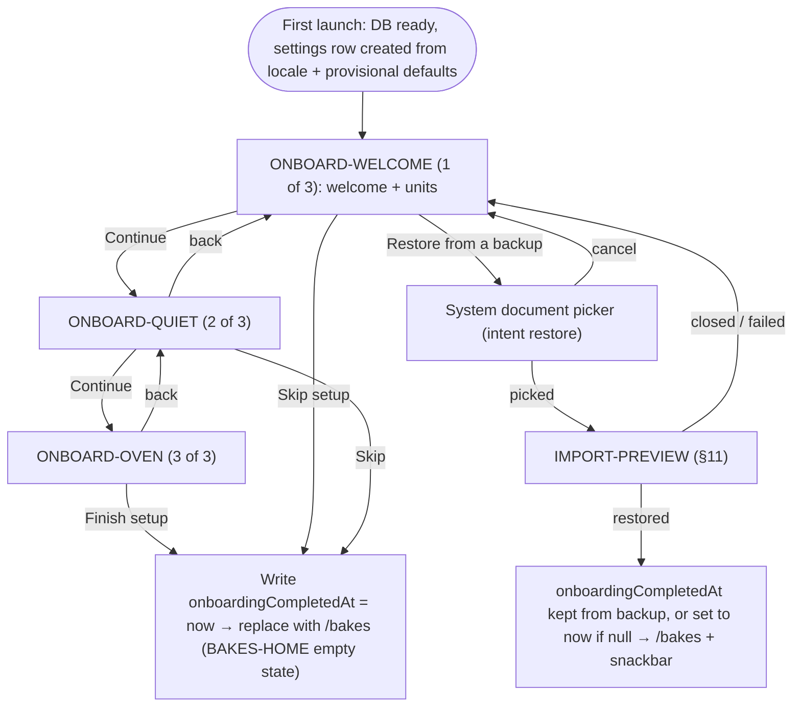
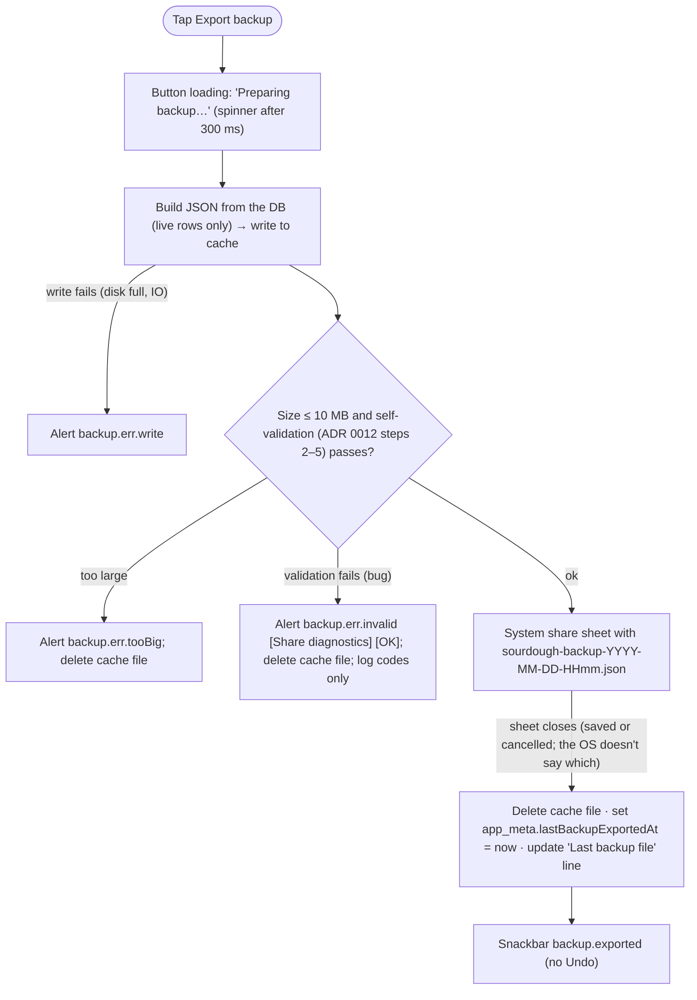
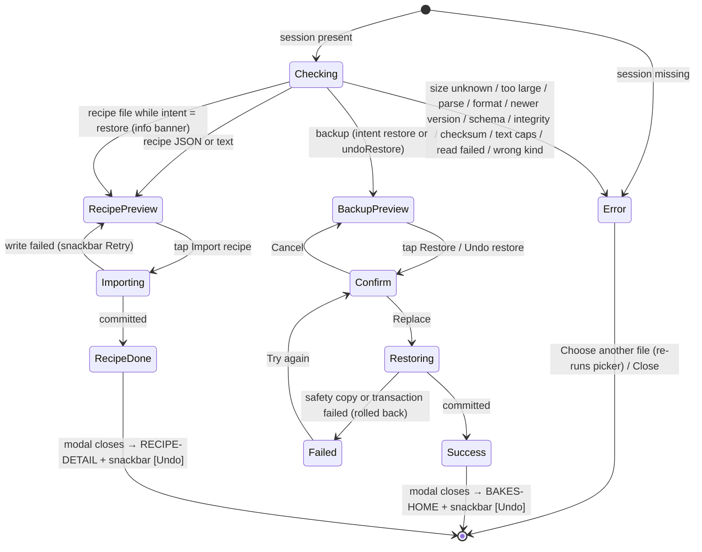

# Sourdough Assistant: screen specs for onboarding, settings, backup and import/export (M6)

DS-04 · 2026-11-26 · ux-ui-designer
Inputs: `docs/design/flows.md`, `tokens.md`, `components.md` (DS-01) · `docs/design/screens-recipes.md` (DS-02) · `docs/architecture.md` §4, §10 to §13, §15 · ADR 0011, 0012, 0015 · `docs/security/threat-model.md` (M3, M4, L4, L6, informational) · `apps/mobile/src/state/settings.ts`, `src/db/types.ts` (`Settings`), `src/lib/locale.ts` · `docs/data-model.md` §2 (settings CHECKs)
Consumers: RN-09 (backup, import, export), RN-10 (onboarding, settings, a11y fixes), DR-03 (review against this file, using the checklist in §16), QA-06, SEC-02

Screens and components use **DS-01 names**. Values are **token names**: no raw hex, px or ms. Field names in `code` match `src/db/types.ts` (camelCase) and `data-model.md` (snake_case columns).

---

## 0. Shared rules for every screen in this file

### 0.1 Screen ID to route

| Screen ID | Route (architecture §4) | Presentation | Params |
|---|---|---|---|
| `ONBOARD-WELCOME` (step 1: welcome + units) | `app/onboarding/index.tsx` | Root stack, full screen, before the tabs | none |
| `ONBOARD-QUIET` (step 2) | `app/onboarding/quiet-hours.tsx` | Push inside onboarding | none |
| `ONBOARD-OVEN` (step 3) | `app/onboarding/oven.tsx` | Push inside onboarding | none |
| ~~`onboarding/notifications.tsx`~~ | **Removed** (see §15.1 decision 1) | | |
| `SETTINGS` | `app/(tabs)/settings/index.tsx` | Tab root | none |
| `SET-UNITS` | `app/(tabs)/settings/units.tsx` | Push | none |
| `SET-QUIET` | `app/(tabs)/settings/quiet-hours.tsx` | Push | none |
| `SET-OVEN` | `app/(tabs)/settings/oven.tsx` | Push | none |
| `SET-COST` | `app/(tabs)/settings/cost.tsx` | Push | none |
| `SET-REMINDERS` | `app/(tabs)/settings/reminders.tsx` | Push | none |
| `SET-BACKUP` | `app/(tabs)/settings/backup.tsx` | Push | none |
| `SET-ABOUT` | `app/(tabs)/settings/about.tsx` | Push | none |
| `DIAG-SHARE` | none: a `Sheet` in `src/features/diagnostics/components` | Sheet over `SET-ABOUT` and every route `ErrorBoundary` | none |
| `RECIPE-PICK` | none: a `Sheet` in `src/features/backup/components` | Sheet over `SETTINGS` ("Export a recipe") | none |
| `EXPORT-RECIPE` | none: a `Sheet` in `src/features/backup/components` | Sheet over `RECIPE-DETAIL` and `SETTINGS` | `recipeId` prop |
| `IMPORT-PREVIEW` | `app/import.tsx` | Root modal: iOS page sheet (large detent only), Android full-screen dialog | **none** (the file comes from `useImportSession`, §0.4) |

### 0.2 Formatting (adds to `screens-recipes.md` §0.2)

| Value | Source | Display rule | Example | Accessibility label |
|---|---|---|---|---|
| Time of day | `quietStartMin`, `quietEndMin` (minutes after midnight) | `TimeText` clock time, locale 12/24 h | `10:00 PM` / `22:00` | "10 PM" |
| Quiet window | both | `{from}–{to}` with an en dash; when `to <= from`, add "overnight" in the summary line | `10:00 PM–6:00 AM` | "10 PM to 6 AM, overnight" |
| Window length | derived | `TimeText` duration | `8 h` | "8 hours" |
| Markup | `markupBps` | `bps / 100` as percent, up to 1 decimal, trailing zeros dropped | `200%` | "200 percent" |
| Rounding step | `sellRoundingCents` | `formatMoney(cents)`; `0` reads "No rounding" | `$0.25` | "25 cents" |
| Heads-up | `headsUpMin` | `{n} min before`; `0` reads "Off" | `10 min before` | "10 minutes before" |
| Oven | `ovenCapacity`, `reheatGapMin` | ICU plural loaves; gap as duration | `2 loaves at a time · 10 min between loads` | same |
| Units summary | `unitSystem`, `temperatureUnit` | `Metric · °C` / `US · °F` | `Metric · °C` | "Metric, Celsius" |
| File date | `exportedAt`, safety-copy time, `lastBackupExportedAt` | `Intl.DateTimeFormat(locale, { dateStyle: 'medium', timeStyle: 'short' })` | `Nov 20, 2026, 6:04 PM` | full form |
| File size | bytes | `Intl.NumberFormat(locale, { style: 'unit', unit: 'megabyte' or 'kilobyte', maximumFractionDigits: 1 })` | `12.4 MB` | "12.4 megabytes" |
| Counts | arrays in validated data | ICU plural | `12 recipes` | same |

### 0.3 Settings write behavior (applies to every `SET-*` screen)

1. **Settings save as you change them** (iOS Settings and M3 convention). There's no Save button, and leaving the screen never asks to discard.
2. Switches, segmented controls, radio lists and steppers write on change through `useSettings.update(patch)`. Writes are serialized by the store queue.
3. Text inputs (markup only) write **on blur or keyboard Done**, and only when valid. An invalid value shows its error and isn't written. Leaving the screen with an invalid value discards it silently, and the field shows the saved value next time.
4. **Write failure:** `update` rejects and the store is unchanged, so the control **reverts to the saved value**. `Snackbar` `common.saveFailed` [Retry] (Retry re-sends the same patch). `haptic.warning`.
5. No snackbar on success. The control's new state is the confirmation (VoiceOver/TalkBack read the new state).
6. **Scope of a change** is stated in a footnote on each screen where it matters, because bakes keep their own copies of some values (`Bake.ovenCapacity`, `reheatGapMin`, `headsUpMin`, `costSnapshot`). See each screen.

### 0.4 File handoff to `IMPORT-PREVIEW` (no route params, SEC-01 M2)

`app/import.tsx` takes no params. The opener runs the system document picker **first**, then hands the picked file over in memory:

1. The opener calls `importService.pick(intent)`, where `intent` is `'restore' | 'recipe' | 'undoRestore'`. That runs `expo-document-picker` (`copyToCacheDirectory: true`, types `application/json`, `text/plain`, `*/*`). For `undoRestore` there's no picker; the service uses the safety-copy path.
2. **Cancel in the picker:** nothing happens. The user stays where they were, with no modal flash.
3. **A file is picked:** the service puts `{ intent, cacheUri, startedAt }` into `useImportSession` (Zustand, in memory, `src/features/backup/store.ts`) and calls `router.push('/import')`.
4. `IMPORT-PREVIEW` reads the session on mount and starts checking. It clears the session and deletes the cache copy when it closes, whatever the outcome.
5. If the session is empty on mount (process death, a stray navigation), the modal shows the `sessionMissing` error (§11.4) with only [Close].

### 0.5 Loading

Settings are hydrated before the first frame (architecture §12), so settings screens never show skeletons. Permission status (`usePermissions`) is read asynchronously: until it resolves (typically under 100 ms) the Reminders row and status card show no value rather than a guess. File work has explicit states ("Checking file…", "Restoring…", "Preparing backup…"), described per screen.

There are no network or offline states anywhere in this file, except the privacy-policy link, which opens the system browser (§10).

### 0.6 Large text (applies everywhere; each screen lists only what's specific to it)

Same rules as `screens-recipes.md` §0.6. Additionally, at `fontScale >= 1.5`:
- Two-option `SegmentedControl`s **stay** segmented (only 3 or more options switch to a picker row, `components.md` §1.2), but their labels may wrap to 2 lines; the segment height grows.
- Onboarding `BottomActionBar` stacks Continue above Skip.
- Count lines in previews ("12 recipes · 30 pantry items · 4 bakes") become one count per line.

### 0.7 Keep-awake during file work

`IMPORT-PREVIEW` calls `activateKeepAwakeAsync('import')` while checking and restoring, and releases it on any exit. A large backup can take several seconds to check, and the screen locking mid-restore would background the app.

---

## 1. `ONBOARD-*` shared rules

**Purpose.** Set the three things that change schedules and costs (units, quiet hours, oven capacity) in under 30 seconds, skippable at every step (M6 done-when). **Notification permission is not asked here.** It's primed at the first "Schedule bake" (`flows.md` §5, `PERM-NOTIF`), when the value is obvious.

**Entry.** `app/index.tsx` redirects to `/onboarding` when `settings.onboardingCompletedAt` is null. It's never shown again once set, including after a restore (§11.7).

### 1.1 Flow

### 1.2 What gets written, and when

| Action | Writes |
|---|---|
| Continue on step 1 | `{ unitSystem, temperatureUnit }` |
| Continue on step 2 | `{ quietHoursEnabled, quietStartMin, quietEndMin }` |
| Finish setup on step 3 | `{ ovenCapacity, onboardingCompletedAt: now }` in one `update` |
| Skip setup / Skip | `{ onboardingCompletedAt: now }` only. Values the user already confirmed with Continue stay; everything else keeps the defaults already in the row (`settings.ts` `PROVISIONAL_SETTINGS_DEFAULTS` + locale). Unconfirmed changes on the current screen are dropped. |
| Back | Nothing (the previous screen shows what was written, or its current local value) |

Write failure on any step: `Snackbar` `common.saveFailed` [Retry]; the user stays on the step with their choices intact.

### 1.3 Shared layout (all three steps)

- No tab bar. iOS: no nav bar on step 1; steps 2 and 3 have a transparent nav bar with the back chevron only (no title; the content heading is the title). Android: no top app bar on step 1; steps 2 and 3 show a top app bar with the back arrow only.
- Content scrolls, centered at `layout.maxContentWidth`, horizontal padding `layout.screenMargin`, top padding `space.xxl` (step 1: `space.xxxl`).
- Order: step label (`caption textSecondary`, "Step 1 of 3"), title (`title1`, `role="header"`), body (`body textSecondary`), then the form, then the footnote `onboard.changeLater` (`footnote textSecondary`, `space.xl` above).
- `BottomActionBar`: `Button primary lg fullWidth` (Continue / Finish setup), and under it `Button text md fullWidth` (Skip setup / Skip), gap `space.sm`. Step 3 has no Skip (Finish is the same thing with the shown value).
- **The forms are the same components as in Settings** (`UnitsForm`, `QuietHoursForm`, `OvenCapacityField` in `src/features/settings/components`), in a "local draft" mode that writes on Continue instead of on change. This keeps both places identical.

### 1.4 Shared states

| State | Treatment |
|---|---|
| Large text | Everything scrolls; the bar stays pinned with matching bottom padding. The step label and title wrap fully |
| Landscape (phone) | Same single column, scrolls. The app glyph on step 1 hides when the window height is under 480, so the form is visible without scrolling |
| Dark mode | Glyph uses its dark variant (`splash-icon-dark`). All colors from tokens |
| Reduce motion | Native push only; no custom animation anywhere in onboarding |
| Android system back on step 1 | Exits the app (onboarding isn't complete, so it shows again next launch) |
| App killed mid-onboarding | Next launch resumes at step 1, with any values already written by Continue preselected |

### 1.5 Shared accessibility

- On each step, focus lands on the step label + title as one heading: "Step 2 of 3. Set your quiet hours."
- Skip has the hint `onboard.skip.hint`.
- Nothing auto-advances.

---

## 2. `ONBOARD-WELCOME` (step 1: welcome + units)

### 2.1 Layout (top to bottom)
1. App glyph image (decorative, `accessible={false}`), 2 × `size.iconHero` square, centered, `space.xl` below.
2. "Step 1 of 3" (`caption textSecondary`).
3. Title `onboard.welcome.title` (`title1`).
4. Body `onboard.welcome.body` (`body textSecondary`).
5. `space.xl`, then subtitle `onboard.units.heading` (`title3`, `role="header"`).
6. **Measurements**: label (`headline`) + `SegmentedControl` [`onboard.units.metric` | `onboard.units.us`], preselected from `settingsDefaultsForLocale`. Helper (`footnote textSecondary`): `settings.units.measure.help`.
7. **Temperature**: label + `SegmentedControl` [°C | °F], preselected. Helper: `settings.units.temp.help`.
8. While both values are still the locale suggestion: `footnote textSecondary` `onboard.units.suggested`. It hides once the user changes either.
9. Text button row (centered, `Button text md`, leading icon `restore` / `clock.arrow.circlepath`): `onboard.restore` ("Moving from another phone? Restore a backup"). Placed in the content, not the bar, so the screen keeps one primary action.
10. Footnote `onboard.changeLater`.
11. `BottomActionBar`: [Continue] / [Skip setup].

### 2.2 Interactions
- Segments: `haptic.selection`, local draft only.
- "Restore a backup": runs the picker with intent `restore` (§0.4). Values on this screen aren't written first.
- Continue: write (§1.2), push `ONBOARD-QUIET`.

### 2.3 Copy
| Key | String |
|---|---|
| `onboard.step` | Step {n} of {total} |
| `onboard.welcome.title` | Bread on time, without the math |
| `onboard.welcome.body` | Pick when you want your loaf ready. Sourdough Assistant works out when to start each step, reminds you, and shows what each loaf costs. |
| `onboard.units.heading` | How do you measure? |
| `onboard.units.metric` | Metric (g, ml) |
| `onboard.units.us` | US (oz, cups) |
| `onboard.units.suggested` | Suggested from your phone's region. |
| `onboard.restore` | Moving from another phone? Restore a backup |
| `onboard.continue` | Continue |
| `onboard.skipSetup` | Skip setup |
| `onboard.skip` | Skip |
| `onboard.skip.hint` | Uses the suggested settings for the rest. You can change them in Settings. |
| `onboard.changeLater` | You can change these any time in Settings. |

(`settings.units.*` strings are in §4.4.)

### 2.4 Accessibility
- Each `SegmentedControl` is a radiogroup labelled "Measurements" / "Temperature", with the helper as its hint.
- Segment labels read "Metric, grams and milliliters" / "US, ounces and cups", "Celsius" / "Fahrenheit" (`accessibilityLabel` overrides, because "°C" and "g, ml" are read poorly).

---

## 3. `ONBOARD-QUIET` (step 2) and `ONBOARD-OVEN` (step 3)

### 3.1 `ONBOARD-QUIET` layout
1. "Step 2 of 3", title `onboard.quiet.title`, body `onboard.quiet.body`.
2. `QuietHoursForm` (identical to `SET-QUIET` §5.1 items 2 to 4): toggle row, From and To fields, window summary.
3. Footnote `onboard.changeLater`. Bar: [Continue] / [Skip].

### 3.2 `ONBOARD-OVEN` layout
1. "Step 3 of 3", title `onboard.oven.title`, body `onboard.oven.body`.
2. `OvenCapacityField`: a `Stepper` (1 to 12, default from the row, normally 1), label `settings.oven.capacity`, value "1 loaf" / "2 loaves". Helper `settings.oven.capacity.help`.
3. The reheat gap is **not** in onboarding (it's a refinement; default 0, Q8). It's in `SET-OVEN`.
4. Footnote `onboard.changeLater`. Bar: [Finish setup] only.

### 3.3 Interactions
- Finish setup: write, `haptic.success`, `router.replace('/(tabs)/bakes')`. No snackbar. Focus goes to the `BAKES-HOME` title, and the empty state (`flows.md` §8) invites the first bake.
- Validation on step 2: same as `SET-QUIET` §5.3. Continue with an invalid window shows the error and doesn't advance.

### 3.4 Copy
| Key | String |
|---|---|
| `onboard.quiet.title` | Set your quiet hours |
| `onboard.quiet.body` | When you plan a bake, steps that start during these hours get a moon tag, so you can change the timing. Nothing moves on its own, and reminders still go off. |
| `onboard.oven.title` | How many loaves fit in your oven? |
| `onboard.oven.body` | When you bake more loaves than fit at once, the app plans oven loads one after another. |
| `onboard.finish` | Finish setup |

---

## 4. `SETTINGS` (tab root)

**Purpose.** One place for everything that changes how schedules, reminders and costs work, plus the user's data.
**Entry points.** Settings tab. Links from `SCHED-PLAN` ("Default from Settings: 2") and banners deep-link to sub-pages with `router.push('/settings/<page>')` (in-app only; not in the deep-link allowlist).

### 4.1 Data
- `useSettings` (`selectSettings`).
- `usePermissions`: `notifications: 'granted' | 'denied' | 'undetermined'`, Android `exactAlarm: 'granted' | 'denied'`, Android `batteryOptimized: boolean`.
- `app_meta.lastBackupExportedAt` (**new key**, §15.2 Q-A1).

### 4.2 Layout (top to bottom)
Header: iOS large title "Settings" over an inset grouped list (`surfaceSunken` background, `surface` rows, `radius.md` sections). Android top app bar "Settings", full-bleed list with M3 subheaders and `border` dividers.

All rows are `ListRow navigation` unless noted. Trailing values are `body textSecondary`.

| # | Section (`SectionHeader`) | Row | Trailing value / control | Opens |
|---|---|---|---|---|
| 1 | Baking | Units | `Metric · °C` | `SET-UNITS` |
| 2 | | Quiet hours | `10:00 PM–6:00 AM` or `Off` | `SET-QUIET` |
| 3 | | Oven | `1 loaf at a time` (+ ` · 10 min between loads` when gap > 0) | `SET-OVEN` |
| 4 | During a bake | Reminders | `On · 10 min heads-up`; `On, may be late` with `StatusTag remindersOff` text override "May be late" (Android exact alarm denied); `StatusTag remindersOff` "Off" (denied); `Not set up` (undetermined) | `SET-REMINDERS` |
| 5 | | Keep screen on | `ListRow toggle` + `Switch` bound to `keepAwakeDefault`. Subtitle `settings.keepAwake.sub` | (toggles) |
| 6 | Cost | Pricing | `200% markup` (+ ` · round up to $0.25`) | `SET-COST` |
| 7 | Your data | Backup and restore | Subtitle: `Last backup file {date}` or `No backup file yet` | `SET-BACKUP` |
| 8 | | Import a recipe | (no value; leading icon `file_download` / `square.and.arrow.down`) | Picker, intent `recipe` (§0.4) |
| 9 | | Export a recipe | (leading icon `ios_share` / `square.and.arrow.up`) | `RECIPE-PICK` sheet → `EXPORT-RECIPE` |
| 10 | About | About and privacy | `Version 1.0.0` | `SET-ABOUT` |

Below the list: `footnote textSecondary`, centered, `space.xl` padding: `settings.footer` ("Everything you enter stays on this phone.").

Notes:
- Row 4's status tag and words carry the state; color is never the only signal.
- Row 5 is a `Switch` here, not a sub-page, because it's one boolean. It's the **same setting** the `BAKE-LIVE` header toggle writes ("the choice is remembered", `flows.md` §6.3).
- `RECIPE-PICK`: a `Sheet` titled "Export a recipe" with a `SearchField` and the recipe rows (name only, favorites first). Tap one to replace the sheet content with `EXPORT-RECIPE` (§12). With no recipes: `EmptyState search` "No recipes to export yet."

### 4.3 States
| State | Treatment |
|---|---|
| Permission status not yet known | Row 4 shows no trailing value |
| Notifications denied | Row 4: `StatusTag remindersOff` "Off" |
| No recipes | Row 9 stays enabled; the sheet shows its empty state |
| Write failure (row 5) | §0.3: switch reverts, snackbar [Retry] |
| Large text | Trailing values move under the title (§0.6). Tags sit on their own line |
| Landscape / tablet | Centered at `layout.maxContentWidth` |

### 4.4 Copy
| Key | String |
|---|---|
| `settings.title` | Settings |
| `settings.section.baking` | Baking |
| `settings.section.duringBake` | During a bake |
| `settings.section.cost` | Cost |
| `settings.section.data` | Your data |
| `settings.section.about` | About |
| `settings.units` | Units |
| `settings.units.summary` | {system} · {temp} |
| `settings.units.metricShort` | Metric |
| `settings.units.usShort` | US |
| `settings.quiet` | Quiet hours |
| `settings.quiet.summary` | {from}–{to} |
| `settings.off` | Off |
| `settings.oven` | Oven |
| `settings.oven.summary` | {count, plural, one {# loaf at a time} other {# loaves at a time}} |
| `settings.oven.summaryGap` | {count, plural, one {# loaf at a time} other {# loaves at a time}} · {gap} between loads |
| `settings.reminders` | Reminders |
| `settings.reminders.on` | On · {min} min heads-up |
| `settings.reminders.onNoHeadsUp` | On |
| `settings.reminders.late` | May be late |
| `settings.reminders.notSetUp` | Not set up |
| `settings.keepAwake` | Keep screen on |
| `settings.keepAwake.sub` | While a bake is open on screen. |
| `settings.pricing` | Pricing |
| `settings.pricing.summary` | {markup} markup |
| `settings.pricing.summaryRound` | {markup} markup · round up to {step} |
| `settings.backup` | Backup and restore |
| `settings.backup.last` | Last backup file {date} |
| `settings.backup.none` | No backup file yet |
| `settings.importRecipe` | Import a recipe |
| `settings.exportRecipe` | Export a recipe |
| `settings.exportRecipe.pickTitle` | Export a recipe |
| `settings.exportRecipe.none` | No recipes to export yet. |
| `settings.about` | About and privacy |
| `settings.about.version` | Version {version} |
| `settings.footer` | Everything you enter stays on this phone. |
| `settings.units.measure` | Measurements |
| `settings.units.measure.help` | Recipes are always saved in grams. This sets the second unit shown next to grams, and how prices per weight are shown. |
| `settings.units.temp` | Temperature |
| `settings.units.temp.help` | Used for kitchen temperature when you schedule a bake. |

### 4.5 Accessibility
- Rows are one stop each: "Quiet hours, 10 PM to 6 AM, overnight", "Reminders, off", "Reminders, on, may be late".
- Row 5 is `role="switch"` for the whole row, label "Keep screen on during bakes", `checked`.
- Section headers are `role="header"`.
- Rows 8 and 9 have hints: "Opens a file picker", "Choose a recipe to share".

### 4.6 Platform
- iOS: rows 1 to 4, 6, 7, 10 show chevrons. Rows 8 and 9 show no chevron (they open system UI or a sheet).
- Android: no chevrons (M3). Leading icons on every row for scannability: `straighten`, `bedtime`, `oven_gen` (fallback `local_fire_department`), `notifications`, `light_mode`, `sell`, `backup`, `file_download`, `ios_share`, `info`. iOS uses the SF equivalents (`ruler`, `moon`, `oven`, `bell`, `sun.max`, `tag`, `externaldrive`, `square.and.arrow.down`, `square.and.arrow.up`, `info.circle`) in the native style without colored squares.

---

## 5. `SET-UNITS` and `SET-QUIET`

### 5.0 `SET-UNITS`
Layout: title "Units" (iOS inline, Android top app bar). The `UnitsForm` from §2.1 items 6 and 7 (no suggestion footnote). Footnote: `settings.units.scope`.

| Key | String |
|---|---|
| `settings.units.title` | Units |
| `settings.units.scope` | Changes how amounts and prices are shown everywhere. Nothing you've saved is converted or changed. |

### 5.1 `SET-QUIET` layout (top to bottom)
1. Intro (`body textSecondary`): `settings.quiet.intro`.
2. `ListRow toggle` "Warn about quiet hours" + `Switch` (`quietHoursEnabled`).
3. When enabled (expands with `motion.duration.standard`, instant with reduce motion; when disabled the fields are **hidden**, not disabled, and their values are kept):
   - `DateTimeField` **time-only mode** "From", value `quietStartMin`.
   - `DateTimeField` time-only "To", value `quietEndMin`.
4. Summary line (`callout`): `settings.quiet.window` ("8 h, overnight") or `settings.quiet.windowSameDay` ("3 h").
5. Footnote: `settings.quiet.scope`.

**New component mode:** `DateTimeField` time-only. iOS: a sheet with time wheels (medium detent, "Done"); Android: M3 `TimePickerDialog` only. Minute interval 5, locale 12/24 h. (DS-02 added the date-only mode; this is its counterpart.)

### 5.2 Behavior
- Each field writes on picker confirm. The Switch writes on change.
- Changing quiet hours re-evaluates warnings everywhere they're computed from Settings (`SCHED-PLAN`, the `BAKE-LIVE` timeline). Nothing is rescheduled and no notification changes.

### 5.3 Validation
| Condition | Where | Key | String |
|---|---|---|---|
| From equals To | Under "To" | `val.quiet.same` | Start and end can't be the same time. |

The value isn't written while invalid. Any From/To pair that differs is valid; `to < from` means overnight.

### 5.4 Copy
| Key | String |
|---|---|
| `settings.quiet.title` | Quiet hours |
| `settings.quiet.intro` | Steps that start during quiet hours get a moon tag when you plan a bake, so you can change the timing. Nothing moves on its own, and reminders still go off. |
| `settings.quiet.toggle` | Warn about quiet hours |
| `settings.quiet.from` | From |
| `settings.quiet.to` | To |
| `settings.quiet.window` | {duration}, overnight |
| `settings.quiet.windowSameDay` | {duration} |
| `settings.quiet.scope` | Applies to all bakes, including ones already planned. |

### 5.5 Accessibility
- Time fields: "From, 10 PM", hint "Opens time picker".
- The summary line is a polite live region (announced after a change).

---

## 6. `SET-OVEN`

### 6.1 Layout
1. Intro: `settings.oven.intro`.
2. `Stepper` "Loaves per oven load" (`ovenCapacity`, 1 to 12). Helper `settings.oven.capacity.help`.
3. `Stepper` "Time between loads" (`reheatGapMin`, 0 to 120, **step 5 min**), value "No gap" at 0, else `TimeText` duration. Helper `settings.oven.gap.help`.
4. Example line (`callout`, live): `settings.oven.example`, e.g. "With 3 loaves: 2 loaves, then 1 loaf 10 min later." Shown only when capacity < 3; otherwise "Up to {n} loaves bake together."
5. Footnote `settings.oven.scope`.

### 6.2 Behavior
Writes on each stepper change (`haptic.selection`), debounced 400 ms so holding a button doesn't queue dozens of writes (the store queue would handle it, but this keeps the DB quiet).

### 6.3 Copy
| Key | String |
|---|---|
| `settings.oven.title` | Oven |
| `settings.oven.intro` | Used when one bake has more loaves than fit in the oven at once. |
| `settings.oven.capacity` | Loaves per oven load |
| `settings.oven.capacity.help` | For example, how many Dutch ovens you bake in at the same time. |
| `settings.oven.gap` | Time between loads |
| `settings.oven.gap.none` | No gap |
| `settings.oven.gap.help` | Time to reheat the oven or Dutch oven before the next load. |
| `settings.oven.example` | With {total} loaves: {first}, then {rest} {gap} later. |
| `settings.oven.exampleNoGap` | With {total} loaves: {first}, then {rest} right after. |
| `settings.oven.together` | Up to {count, plural, one {# loaf bakes} other {# loaves bake}} together. |
| `settings.oven.scope` | Used as the starting value when you plan a bake. Bakes already planned keep their own oven plan. |

### 6.4 Accessibility
Both steppers are `role="adjustable"` ("Loaves per oven load, 2 loaves"; "Time between loads, 10 minutes"). The example line is a polite live region.

---

## 7. `SET-COST` (markup and price rounding)

### 7.1 Layout
1. Intro: `settings.cost.intro`.
2. `TextField number` "Markup", suffix "%", value `markupBps / 100`. Helper `settings.cost.markup.help`.
3. `SectionHeader` "Round the suggested price up to". A radio list (`ListRow selectable`, radio) built from the currency's minor digits:
   - 2-decimal currencies: No rounding · 0.05 · 0.10 · 0.25 · 0.50 · 1.00 (shown with `formatMoney`: "$0.05").
   - 0-decimal currencies (JPY, KRW…): No rounding · 10 · 50 · 100 · 500 major units.
   - 3-decimal currencies: No rounding · 0.050 · 0.100 · 0.250 · 0.500 · 1.000.
   - Stored as `sellRoundingCents` (minor units, ≤ 10,000 per the CHECK).
4. **Example card** (`Card`, `surfaceSunken`, no elevation, not tappable), live:
   - When a recipe with a complete cost exists (first favorite, else most recently updated): `settings.cost.example` ("Country loaf costs $1.39 a loaf. Suggested price: $4.17.").
   - Otherwise: the same sentence with a generic cost of one major unit ("A loaf that costs $1.00 …").
5. **Currency** read-only `ListRow value`: "Currency · US dollar (USD)". Subtitle `settings.cost.currency.help`. (No picker in v1, A5.)
6. Footnote `settings.cost.scope`.

### 7.2 Behavior
- Markup writes on blur / Done when valid: `markupBps = round(value × 100)`.
- The radio list writes on tap (`haptic.selection`).
- The example uses core `sellPrice` with the current draft values (unsaved markup too), so it updates as the user types.

### 7.3 Validation
| Condition | Key | String |
|---|---|---|
| Empty | `val.markup.empty` | Enter a markup, or 0 for none. |
| Not a number | `val.markup.nan` | Enter a number like 200. |
| Negative | `val.markup.negative` | Markup can't be negative. |
| Over 10,000 | `val.markup.max` | Use 10,000% or less. |
| More than 1 decimal | `val.markup.decimals` | Use at most 1 decimal place. |

### 7.4 Copy
| Key | String |
|---|---|
| `settings.cost.title` | Pricing |
| `settings.cost.intro` | Sets the suggested sell price on each recipe. It's only a suggestion; nothing is sold through the app. |
| `settings.cost.markup` | Markup |
| `settings.cost.markup.help` | Added on top of ingredient cost. 200% means the price is 3 times the cost. |
| `settings.cost.rounding` | Round the suggested price up to |
| `settings.cost.rounding.none` | No rounding |
| `settings.cost.example` | {recipe} costs {cost} a loaf. Suggested price: {price}. |
| `settings.cost.exampleGeneric` | A loaf that costs {cost} would sell for {price}. |
| `settings.cost.currency` | Currency |
| `settings.cost.currency.help` | From your phone's region. |
| `settings.cost.scope` | Recipe prices update right away. Bakes you've already planned keep their price. |

### 7.5 Accessibility
- Markup field: "Markup, percent". Error appended per `components.md` §3.7.
- The rounding list is a radiogroup labelled "Round the suggested price up to".
- The example card is one stop, a polite live region throttled to 1 s after typing stops.

---

## 8. `SET-REMINDERS` (heads-up, permission status, delivery health)

### 8.1 Layout (top to bottom)
1. **Status `Card`** (not tappable as a whole), content by state:

| State | Icon | Title (`title3`) | Body (`callout`) | Action |
|---|---|---|---|---|
| Granted, healthy | `notifications_active` / `bell.badge` (`success`) | `rem.status.on` | `rem.status.on.body` | none |
| Granted, Android exact alarms denied | `alarm` / n/a (`warning`) | `rem.status.late` | `rem.status.late.body` | `Button tonal md` `rem.allowAlarms` → `requestExactAlarmPermissionsAsync()` |
| Denied | `notifications_off` / `bell.slash` (`warning`) | `rem.status.off` | `rem.status.off.body` | `Button tonal md` `rem.openSettings` → `Linking.openSettings()` |
| Undetermined | `notifications` / `bell` (`textSecondary`) | `rem.status.unset` | `rem.status.unset.body` | `Button tonal md` `rem.turnOn` → system prompt directly (this screen's body is the primer) |

   The icon is decorative; the title carries the state.
2. **Android only, `SectionHeader` "Delivery"**:
   - `ListRow value` "Alarms and reminders" · "Allowed" / "Not allowed". Tap opens the same system screen as `rem.allowAlarms`.
   - `ListRow value` "Battery optimization" · "Off" / "On". When On, the subtitle is `rem.battery.on` and tapping opens `Settings.ACTION_IGNORE_BATTERY_OPTIMIZATION_SETTINGS`.
   - A collapsed row `rem.battery.tips` ("Tips for {brand} phones") expands in place to 2 to 4 short sentences for the detected manufacturer (`Platform.constants.Manufacturer`: Samsung, Xiaomi/Redmi/POCO, OnePlus/OPPO/realme, Huawei/Honor, Google, other). The text is bundled; no network (ADR 0011).
3. **iOS only**: footnote `rem.ios.focus` under the card.
4. **`SectionHeader` "Heads-up before each step"**: radio list Off · 5 · 10 · 15 · 30 · 60 min (`headsUpMin`). Footer `rem.headsUp.help` and `rem.headsUp.scope`.
5. **`SectionHeader` "Check"**: `Button outline md` `rem.test`. Disabled unless granted (hint `rem.test.disabledHint`). It schedules one notification 10 s out on the `bake-steps-v1` channel, title `rem.test.notifTitle`, body `rem.test.notifBody`, id namespace `satest:` (outside the `sa1:` namespace so reconcile never cancels it, §15.2 Q-A5). Then `Snackbar` `rem.test.sent`.

### 8.2 Behavior
- `usePermissions.refresh()` runs on focus and on app foreground, so returning from system settings updates the card without a tap. A change to granted triggers the reconcile `rebuild` (ADR 0011), and `Snackbar` `rem.nowOn`.
- Heads-up writes on tap.

### 8.3 Copy
| Key | String |
|---|---|
| `rem.title` | Reminders |
| `rem.status.on` | Reminders are on |
| `rem.status.on.body` | You'll get an alert when each step starts, even with the app closed. |
| `rem.status.late` | Reminders may be late |
| `rem.status.late.body` | Android can delay reminders to save battery. Allow alarms and reminders so each step alerts you within a minute. |
| `rem.allowAlarms` | Allow on-time reminders |
| `rem.status.off` | Reminders are off |
| `rem.status.off.body` | Your bakes still work, but you won't be alerted when a step starts. Turn on notifications for Sourdough Assistant in your phone's settings. |
| `rem.openSettings` | Open settings |
| `rem.status.unset` | Reminders aren't set up yet |
| `rem.status.unset.body` | Get an alert when it's time to feed, fold, shape and bake, even overnight and with the app closed. |
| `rem.turnOn` | Turn on reminders |
| `rem.delivery` | Delivery |
| `rem.alarms` | Alarms and reminders |
| `rem.allowed` | Allowed |
| `rem.notAllowed` | Not allowed |
| `rem.battery` | Battery optimization |
| `rem.battery.on` | If reminders arrive late, set Sourdough Assistant's battery use to Unrestricted. |
| `rem.battery.tips` | Tips for {brand} phones |
| `rem.battery.tipsOther` | Tips for your phone |
| `rem.ios.focus` | Step reminders are Time Sensitive, so they can come through Focus and Sleep if you allow Time Sensitive notifications for this app. |
| `rem.headsUp` | Heads-up before each step |
| `rem.headsUp.off` | Off |
| `rem.headsUp.option` | {min} min before |
| `rem.headsUp.help` | A quieter alert before each step, so you have time to get ready. |
| `rem.headsUp.scope` | Applies to bakes you plan from now on. |
| `rem.check` | Check |
| `rem.test` | Send a test reminder |
| `rem.test.disabledHint` | Turn on reminders first. |
| `rem.test.notifTitle` | Test reminder |
| `rem.test.notifBody` | This is how step reminders look. |
| `rem.test.sent` | Test reminder in 10 seconds. Lock your phone to see it on the lock screen. |
| `rem.nowOn` | Reminders on. |

Battery tip strings (`rem.tips.samsung`, `.xiaomi`, `.oneplus`, `.huawei`, `.google`, `.other`) are written by RN-10 from the AN-01 findings in `docs/native/android-notifications.md`, in the same voice: imperative, one action per sentence, menu names in quotes as the phone shows them.

### 8.4 Accessibility
- The status card is one stop (title + body), with its button as a separate stop.
- The card's title change after returning from settings is announced (polite).
- The heads-up list is a radiogroup.

### 8.5 Platform
- iOS has no "Delivery" section; Android has no Focus footnote.
- iOS "Open settings" opens the app's page in Settings; Android opens the app's notification settings (`Linking.openSettings()` lands on App info, which is acceptable; RN-10 may use the `APP_NOTIFICATION_SETTINGS` intent if available without a new dependency).

---

## 9. `SET-BACKUP`

**Purpose.** Make one file with everything, restore one, or undo the last restore (M6 done-when: a backup from one phone restores on the other).
**Entry points.** `SETTINGS` "Backup and restore".

### 9.1 Layout (top to bottom)
1. Intro (`body`): `backup.intro`.
2. **`SectionHeader` "Back up"**:
   - `Button primary md fullWidth` `backup.export` ("Export backup"). This is the screen's one primary action.
   - Footnote (`footnote textSecondary`, with a leading `info` icon) `backup.contents` (threat model L4f).
   - Footnote `backup.last` ("Last backup file: Nov 20, 2026, 6:04 PM") or `backup.never`.
3. **`SectionHeader` "Restore"**:
   - `Button outline md fullWidth` `backup.restore` ("Restore from a backup…").
   - Footnote `backup.restore.help`.
4. **`SectionHeader` "Undo last restore"**, shown only when a safety copy exists:
   - `ListRow navigation` title `backup.undo`, subtitle `backup.undo.sub` ("Puts back this phone's data from before {date}").
5. Bottom padding `space.xxl`.

### 9.2 Export flow and states

| State | Treatment |
|---|---|
| Idle | As 9.1 |
| Preparing | Export button `loading` (label stays, spinner, `busy`), Restore button disabled. Typical under 1 s |
| Share sheet open | Native |
| Write / size / validation failure | Native alert (copy §9.5). No file is shared |
| Sharing unavailable (`Sharing.isAvailableAsync()` false) | Alert `backup.err.noShare` |
| After the sheet closes | Snackbar `backup.exported`, which is honest about not knowing whether it was saved |

### 9.3 Restore entry
"Restore from a backup…" runs the picker with intent `restore` (§0.4), then `IMPORT-PREVIEW` handles everything (§11).

### 9.4 Undo last restore
- Tapping the row runs `importService.pick('undoRestore')`, which uses the safety copy path (no picker) and opens `IMPORT-PREVIEW` in undo mode: it checks the safety copy through the **same pipeline** (it's a file, so it's validated like any other), then shows the confirm with counts (§11.6, undo variant).
- After a successful undo, the safety copy is replaced by a copy of the data that was just replaced (ADR 0012 step 7 always runs), so the row keeps meaning "put back what was here before the last restore". Nothing is ever lost by pressing it twice.
- The row's date is the safety copy's write time (`app_meta.lastRestoreSafetyAt`, **new key**, §15.2 Q-A1; file mtime is a fallback).

### 9.5 Copy
| Key | String |
|---|---|
| `backup.title` | Backup and restore |
| `backup.intro` | A backup is one file with everything in the app. Save it somewhere off this phone, like Files, Google Drive or email, so you can restore it on a new phone. |
| `backup.section.backUp` | Back up |
| `backup.export` | Export backup |
| `backup.preparing` | Preparing backup… |
| `backup.contents` | The file contains all your recipes, pantry items and prices, price history, bakes and settings. It isn't encrypted, so anyone with the file can read it. |
| `backup.last` | Last backup file: {date} |
| `backup.never` | You haven't made a backup file on this phone yet. |
| `backup.section.restore` | Restore |
| `backup.restore` | Restore from a backup… |
| `backup.restore.help` | Replaces everything on this phone with the backup. You'll see what's in the file and confirm before anything changes. |
| `backup.section.undo` | Undo last restore |
| `backup.undo` | Undo last restore |
| `backup.undo.sub` | Puts back this phone's data from before {date}. |
| `backup.exported` | Backup file created. Keep it somewhere safe. |
| `backup.err.title` | Couldn't create the backup |
| `backup.err.write` | The file couldn't be saved. Free up some space on your phone and try again. |
| `backup.err.tooBig` | Your data is larger than a backup can hold (10 MB). Please share diagnostics so this can be fixed. |
| `backup.err.invalid` | Something in your data didn't pass the backup check, so no file was made. Please share diagnostics so this can be fixed. |
| `backup.err.noShare` | Sharing isn't available on this phone. |
| `common.shareDiagnostics` | Share diagnostics |
| `common.ok` | OK |

### 9.6 Accessibility
- The Export button announces busy while preparing, then the snackbar is announced.
- `backup.contents` is part of the Export button's hint: "Creates one file with all your recipes, prices, bakes and settings. The file isn't encrypted."
- The undo row hint: "Shows what will be put back before anything changes."

---

## 10. `SET-ABOUT` and `DIAG-SHARE`

### 10.1 `SET-ABOUT` layout
1. Header block (centered): app glyph (decorative, `size.iconHero`), app name (`title2`), `about.version` (`subhead textSecondary`, "Version 1.0.0 (12)").
2. **`SectionHeader` "Privacy"**: a `Card` (`surfaceSunken`, not tappable) with `about.privacy.body` and the variant sentence below it:
   - H1 option (a), no `expo-updates`: `about.privacy.noNetwork`.
   - H1 option (b): `about.privacy.updates`.
   - Always: `about.privacy.osBackup` (ADR 0015 §6: the OS backup may include app data).
3. `ListRow navigation` `about.policy`, trailing `open_in_new` / `arrow.up.right.square` icon. Opens the privacy policy URL (Q9) in the system browser (`Linking.openURL`; not an in-app web view). Hint `about.policy.hint`.
4. **`SectionHeader` "Help"**: `ListRow navigation` `about.diagnostics` → `DIAG-SHARE`. Subtitle `about.diagnostics.sub`.
5. *(Optional, flag `flags.licenses`)* `ListRow navigation` "Open-source licenses" → a plain list screen. Ship only if RN-10 can generate the list at build time without a new runtime dependency.

### 10.2 `DIAG-SHARE` (sheet; threat model L6)
Layout (iOS form sheet, medium/large detents; Android modal bottom sheet):
1. Title `diag.title`. Body `diag.body`.
2. `SectionHeader` "Included" + a list with `check` icons (decorative): `diag.inc.app`, `diag.inc.device`, `diag.inc.events`, `diag.inc.settings`.
3. `SectionHeader` "Never included" + a list with `block` / `nosign` icons: `diag.exc.names`, `diag.exc.notes`, `diag.exc.prices`, `diag.exc.files`.
4. A disclosure row `diag.preview` ("Show what's in the file"), `expanded` state. Expanded: the exact text that will be shared, in a scrollable, selectable block (`footnote`, platform monospace font, `surfaceSunken`, `radius.sm`, max height half the window, its own scroll). No new token: monospace is `Menlo` / `monospace` set inside the `DiagnosticsPreview` component only.
5. Pinned: `Button primary lg fullWidth` `diag.share`. Writes `sourdough-diagnostics-YYYY-MM-DD-HHmm.txt` to cache, opens the share sheet, deletes the file after it closes.

| State | Treatment |
|---|---|
| No events recorded | Under "Included": `footnote textSecondary` `diag.empty`. Sharing still works (app and device details only) |
| Write failure | Alert `diag.err` |
| From an `ErrorBoundary` | The same sheet, opened over the error screen |

### 10.3 Copy
| Key | String |
|---|---|
| `about.title` | About |
| `about.version` | Version {version} ({build}) |
| `about.section.privacy` | Privacy |
| `about.privacy.body` | Your recipes, prices and bakes are stored only on this phone. There's no account, no ads and no analytics. |
| `about.privacy.noNetwork` | The app doesn't connect to the internet. |
| `about.privacy.updates` | The only time the app connects to the internet is to check for app updates. |
| `about.privacy.osBackup` | Your phone's own backup (iCloud or Google) may include this app's data, depending on your phone's settings. |
| `about.policy` | Privacy policy |
| `about.policy.hint` | Opens in your browser. |
| `about.section.help` | Help |
| `about.diagnostics` | Share diagnostics |
| `about.diagnostics.sub` | Send a file that helps fix problems. |
| `diag.title` | Share diagnostics |
| `diag.body` | If something went wrong, this file helps fix it. You choose where it goes; nothing is sent automatically. |
| `diag.included` | Included |
| `diag.inc.app` | App version and build |
| `diag.inc.device` | Phone model and system version |
| `diag.inc.events` | Recent app events with times, like "reminders scheduled" or "restore failed" |
| `diag.inc.settings` | Your settings, like oven capacity and quiet hours |
| `diag.never` | Never included |
| `diag.exc.names` | Recipe, step and ingredient names |
| `diag.exc.notes` | Notes |
| `diag.exc.prices` | Prices |
| `diag.exc.files` | Names or contents of files you imported |
| `diag.preview` | Show what's in the file |
| `diag.empty` | No events recorded yet, so the file only has app and phone details. |
| `diag.share` | Share diagnostics |
| `diag.err` | Couldn't create the diagnostics file. Try again. |

### 10.4 Accessibility
- The privacy card is one stop.
- The preview block is a single text element with `accessibilityLabel` `diag.preview` and the full text readable by swiping into it (iOS) / exploring (TalkBack); it's `selectable`.

---

## 11. `IMPORT-PREVIEW` (backup restore and recipe import)

**Purpose.** Check a picked file before anything is written, show exactly what it holds, and either import a recipe or (after a destructive confirm) replace all data. Covers M6 "malformed or wrong-version file is rejected with a clear message and no data changes".
**Entry points.** `SET-BACKUP` restore and undo; `SETTINGS` "Import a recipe"; `RECIPE-LIST` overflow "Import recipe" (DS-02 §5.2); `ONBOARD-WELCOME` "Restore a backup". Always via §0.4.

### 11.1 Header
- iOS: page sheet, **large detent only**, no grabber-dismiss while checking or restoring (`isModalInPresentation`). Leading "Cancel"; title by state; no trailing button (the primary action is pinned at the bottom).
- Android: full-screen dialog, leading close (X), title by state. System back = Cancel, except while restoring (§11.6).

| State | Title |
|---|---|
| Checking | `imp.title.checking` "Checking file" |
| Backup preview | `imp.title.backup` "Restore backup" |
| Undo preview | `imp.title.undo` "Undo last restore" |
| Recipe preview | `imp.title.recipe` "Import recipe" |
| Error | `imp.title.error` "Can't use this file" |
| Restoring | `imp.title.restoring` "Restoring" |

### 11.2 State machine

### 11.3 Checking (threat model M3)
- Layout: centered column, `space.xxxl` top: an indeterminate progress indicator (iOS `ActivityIndicator` large; Android M3 circular indeterminate), `title2` `imp.checking`, `body textSecondary` stage text, which updates as the pipeline advances: `imp.stage.size` → `imp.stage.read` → `imp.stage.check` → `imp.stage.links`.
- After 3 s still checking: an extra `footnote` `imp.checking.slow`.
- Button: `Button text md` "Cancel" (same as header Cancel). Cancelling discards the result and closes; nothing was written.
- Accessibility: the container has `busy`; the title is announced on open; stage text is **not** a live region (it would chatter), but `imp.checking.slow` is announced once.
- Reduce motion: the indicator still rotates (it's a status indicator, not decoration); iOS and Android both keep their system indicators.

### 11.4 Error state (nothing written, ever)
Layout: `EmptyState error` adapted: `size.iconHero` error icon (decorative), `title2` title, `body` message, then **always** the reassurance line `imp.err.nothingChanged` (`callout`, with a `check_circle` / `checkmark.circle` icon, `success` color, icon + words). Then:
- `Button primary md` `imp.err.another` ("Choose another file"): re-runs the picker with the same intent; cancel in the picker leaves this error showing.
- `Button text md` `imp.err.close`.
- For `invalid` and `checksumMismatch` only: a disclosure `imp.err.details` ("Technical details") that expands to up to 3 lines, each `{path} · {code}` (e.g. `data.recipes[3].name · too_long`), in `footnote textSecondary`. **Never** file content (ADR 0012 step 5). A line `imp.err.detailsMore` when there are more than 3.

| Code | Title | Message |
|---|---|---|
| `sessionMissing` | `imp.err.session.t` Nothing to import | `imp.err.session.m` Choose a file to import. |
| `readFailed` | `imp.err.read.t` Couldn't open this file | `imp.err.read.m` Try again. If it's in a cloud folder, save it to your phone first, then pick it from there. |
| `sizeUnknown` | `imp.err.read.t` | `imp.err.size.m` The app couldn't check this file's size, so it didn't open it. Save it to your phone first, then pick it from there. |
| `tooLargeBackup` (> 10 MB) | `imp.err.big.t` This file is too big | `imp.err.big.backup` Backups can be up to 10 MB, and this file is {size}. Check that you picked a Sourdough Assistant backup. |
| `tooLargeRecipe` (> 1 MB JSON) | `imp.err.big.t` | `imp.err.big.recipe` Recipe files can be up to 1 MB, and this file is {size}. |
| `tooLargeText` (> 64 KB, > 500 lines, or a line > 500 chars) | `imp.err.big.t` | `imp.err.big.text` Text recipes can be up to 64 KB and 500 lines, with up to 500 characters on a line. |
| `empty` | `imp.err.empty.t` This file is empty | `imp.err.notOurs.m` |
| `notOurs` (parse fails, or `format` unknown, and not parseable as our text grammar) | `imp.err.notOurs.t` This isn't a Sourdough Assistant file | `imp.err.notOurs.m` Pick a backup or recipe file made by Sourdough Assistant. Text recipes need to be in the format the app exports. |
| `newerVersion` | `imp.err.newer.t` Made by a newer version | `imp.err.newer.m` This file was made by a newer version of Sourdough Assistant. Update the app on this phone, then try again. |
| `invalid` (Zod, references, anchors, `validateSteps`, row caps, duplicate ids) | `imp.err.invalid.t` This file has problems | `imp.err.invalid.m` Part of the file isn't what the app expects, so it can't be used. It may have been edited, or only partly copied. |
| `checksumMismatch` | `imp.err.damaged.t` This file looks damaged | `imp.err.damaged.m` Its contents don't match the check value saved inside it, so it may have been changed or only partly copied. Try another copy of the backup. |
| `wrongKindBackup` (a full backup picked with intent `recipe`) | `imp.err.isBackup.t` This is a full backup | `imp.err.isBackup.m` It holds all of a phone's data, not one recipe. Restoring it replaces everything here, so that's done from Settings › Backup and restore. Primary button becomes `imp.err.goBackup` "Go to Backup and restore" (closes the modal and pushes `SET-BACKUP`); secondary `imp.err.another`. |
| `textNothingParsed` | `imp.err.noRecipe.t` Couldn't find a recipe | `imp.err.noRecipe.m` Text import only reads recipes exported from Sourdough Assistant as plain text. |

The checksum is never described as "verified", "authentic" or "safe" anywhere (threat model, informational).

### 11.5 Backup preview (counts from validated data only; threat model M4)
Layout, top to bottom (scrolls; `BottomActionBar` pinned):
1. `Banner warning` (icon `warning`): `imp.backup.replaceWarning` "Restoring replaces everything on this phone."
2. Heading block: `title2` `imp.backup.from` ("Backup from Nov 20, 2026, 6:04 PM"); `subhead textSecondary` `imp.backup.source` ("Made on Android · version 1.0.0 (12)"). Both from validated fields `exportedAt`, `app.platform`, `app.version`, `app.build`.
3. `SectionHeader` "In this backup": `ListRow value` rows (not tappable), counts **computed from the validated `data` arrays**. The file's own `counts` field is only cross-checked (a mismatch is an `invalid` error) and never displayed:
   - Recipes · `{n}`
   - Pantry items · `{n}` (subtitle "{p} prices in history")
   - Bakes · `{n}` (subtitle "{a} in progress or planned" when a > 0, counting `status IN ('scheduled','active')`)
   - Settings · "Included"
4. `SectionHeader` "On this phone now": the same rows from the current DB (live rows only). This is what will be replaced.
5. Conditional banners (all `Banner`, in this order):
   - This phone has active or planned bakes: `Banner warning` `imp.backup.localBakes` ("Your {n} planned or in-progress bakes on this phone will be replaced, and their reminders removed.")
   - Backup has active/planned bakes: `Banner info` `imp.backup.reminders` ("Reminders will be set again for {n} bakes. Steps that are already past won't remind you.")
   - Backup `locale.currency` differs from this phone's currency: `Banner info` `imp.backup.currency` (§15.2 Q-A3).
   - `formatVersion` older than current (upgraded): `footnote textSecondary` `imp.backup.upgraded`.
   - Intent `restore` but a recipe file was picked: not here; see §11.8.
6. Footnote `imp.backup.safety` ("Before restoring, the app keeps a copy of this phone's data so you can undo.")
7. `BottomActionBar`: `Button destructive lg fullWidth` (danger fill) `imp.backup.restore` "Restore this backup" (undo mode: `imp.undo.restore` "Put back earlier data").

**Undo mode differences** (intent `undoRestore`): title "Undo last restore"; the heading reads `imp.undo.from` ("Data from before {date}"); no source line; the warning banner reads `imp.undo.warning` ("Changes made since the restore will be lost.").

### 11.6 Confirm, restoring, success, failure

**Confirm** (native alert, destructive style; `components.md` §3.25). Counts in the body come from the validated data and the current DB, never from the file's `counts`:
- Title `imp.confirm.t` "Replace all data on this phone?"
- Body `imp.confirm.m`: "This phone's {localRecipes}, {localPantry} and {localBakes} will be replaced with the backup's {recipes}, {pantry} and {bakes}. A copy of this phone's data is kept so you can undo."
- Buttons: [Replace] (destructive) · [Cancel] (cancel style, default).
- Undo mode: title `imp.confirmUndo.t` "Put back earlier data?", the same body pattern, [Put back] · [Cancel].

**Restoring** (not cancellable):
- Content replaces the preview: indeterminate indicator, `title2` `imp.restoring`, stage text `imp.stage.safety` → `imp.stage.replace` → `imp.stage.reminders`, and `footnote` `imp.restoring.keepOpen` ("Keep the app open. This takes a few seconds.").
- Header Cancel/X hidden. iOS: swipe-dismiss blocked. Android: system back is consumed and announces `imp.restoring.wait` ("Restoring. Please wait.").
- Keep-awake active (§0.7). `busy` state on the container.

**Success** (after commit + invalidate + settings re-hydrate + reconcile `rebuild`, ADR 0012 step 9):
- `haptic.success`. The modal closes and the app navigates to `/(tabs)/bakes` (`router.dismissAll()` then `replace`). If restored from onboarding, `onboardingCompletedAt` is kept from the backup, or set to now when the backup's is null.
- `Snackbar` `imp.restored` ("Backup restored: {recipes}, {bakes}.") with [Undo]. Undo runs the undo-restore path **without** the preview or confirm (the user just did it, within 8 s), showing the Restoring state in a fresh `IMPORT-PREVIEW`, then `Snackbar` `imp.undone` ("Earlier data put back.").
- Undo mode success: `Snackbar` `imp.undone`, no Undo action (the row in `SET-BACKUP` serves that).
- If notification scheduling partly fails after commit: the restore still succeeded; `BAKES-HOME` shows the existing "Some reminders couldn't be set" banner (architecture §13).
- If notifications aren't granted and the backup has active bakes: the existing reminders-off banner shows on `BAKES-HOME` (`flows.md` §5.3). No prompt is shown by the restore.

**Failure** (all-or-nothing; rolled back):

| Where it failed | Title | Message | Actions |
|---|---|---|---|
| Safety copy couldn't be written (before any DB change) | `imp.fail.t` "Restore didn't happen" | `imp.fail.safety` "The app couldn't save a copy of this phone's data first, so it didn't restore anything. Free up some space and try again." | [Try again] (back to Confirm) · [Close] |
| Transaction error (rolled back) | `imp.fail.t` | `imp.fail.tx` "Something went wrong while restoring, so nothing was changed." | [Try again] · [Share diagnostics] · [Close] |

Both show `imp.err.nothingChanged` with its icon, as in §11.4. The layout is the §11.4 error layout. `haptic.warning`.

### 11.7 Recipe preview and import
Layout (scrolls; `BottomActionBar` pinned):
1. Heading: `title1` recipe name (sanitized, wraps fully). `subhead textSecondary`: `imp.recipe.source.json` "Recipe file" or `imp.recipe.source.text` "Text file".
2. Summary line (`callout numeric`): "{n} ingredients · {m} steps · {loaves} · {hydration} hydration", computed with core `hydrationPct` on the parsed lines. Hydration `–` when there's no flour.
3. Banners (in order, only when they apply):
   - **Skipped text lines**: `Banner warning` `imp.recipe.skipped` ("{n} lines couldn't be read and will be left out.") with an expand action "Show lines" listing up to 20 as `Line {k}: {text}` (text cut to 80 characters and sanitized; this is the user's own file shown to them, not logged), then "+{n} more".
   - **Name already used**: `Banner info` `imp.recipe.dupName` ("You already have a recipe called {name}. This one will be added as {newName}."), where `newName` = `{name} (2)`, incrementing.
   - **New pantry items**: `Banner info` `imp.recipe.newPantry` ("{n} new pantry items will be added.") with a count of unpriced ones: "{u} have no price yet."
   - **Prices dropped for currency**: `Banner info` `imp.recipe.currency` ("Prices in this file are in {currency}, so they weren't added. Add your own prices in the pantry.").
   - **No steps**: `Banner warning` `imp.recipe.noSteps` ("This recipe has no steps. Add them before you plan a bake with it.")
   - **No flour line**: `Banner info` `imp.recipe.noFlour` ("No flour found, so hydration and baker's percentages can't be worked out yet.")
4. `SectionHeader` "Ingredients": `ListRow value` per line: title = name; trailing `QuantityText`; subtitle = role label + pantry match: `imp.recipe.matches` "Matches your pantry item" or `StatusTag` text override `imp.recipe.newItem` "New pantry item" (with `add_circle` icon, `surfaceSunken`/`textSecondary` colors) or `StatusTag unpriced` when new and unpriced.
5. `SectionHeader` "Steps ({m}, about {span})": collapsed by default, a disclosure row "Show steps" that expands to compact rows "{name} · {duration}" (alongside rows indented).
6. `BottomActionBar`: `Button primary lg fullWidth` `imp.recipe.import` "Import recipe".

**Import**: one transaction creates the recipe (new ids, ADR 0012), its lines and steps, and any new pantry items (with prices when the currency matches). Invalidates `recipes.all` and `pantry.all`. Then the modal closes and `router.push('/recipes/<newId>')` (switches to the Recipes tab), with `Snackbar` `imp.recipe.done` ("Recipe imported.") [Undo]. Undo soft-deletes the recipe and the pantry items this import created.

Write failure: stays on the preview, `Snackbar` `common.saveFailed` [Retry].

### 11.8 Mixed-intent cases
| Intent | File | Result |
|---|---|---|
| `restore` | Backup | §11.5 |
| `restore` | Recipe (JSON or text) | Recipe preview (§11.7) with a top `Banner info` `imp.mixed.recipe` ("This is a single recipe, not a backup. You can add it to your recipes; nothing else changes.") |
| `recipe` | Recipe | §11.7 |
| `recipe` | Backup | Error `wrongKindBackup` (§11.4). A full replace is never reachable from "Import recipe" |
| `undoRestore` | Safety copy | §11.5 undo mode. If the safety copy is missing or fails checks: error `invalid` with title `imp.err.undoGone.t` "Can't undo the last restore" and message `imp.err.undoGone.m` "The saved copy from before the restore can't be used." |

### 11.9 States not covered above
| State | Treatment |
|---|---|
| Large text | Count rows stack values (§0.6). The heading wraps fully. Banner messages expand beyond 3 lines. The bar stays pinned |
| Very long recipe name (200 chars from a file) | Wraps fully in the heading (no truncation in a preview) |
| Many ingredients (500 lines) | FlashList; the bar stays pinned |
| App backgrounded while checking | Checking continues when foregrounded. If the OS killed the app, nothing was written; the session is gone, so the next launch starts clean |
| App killed while restoring | The SQLite transaction rolls back; the next launch shows the old data. The safety copy may exist; the undo row then offers a copy of the **current** data, which is harmless |
| Dark mode, landscape | Token colors; single column at `layout.maxContentWidth` |

### 11.10 Copy (keys not already listed in the tables above)
| Key | String |
|---|---|
| `imp.title.checking` | Checking file |
| `imp.title.backup` | Restore backup |
| `imp.title.undo` | Undo last restore |
| `imp.title.recipe` | Import recipe |
| `imp.title.error` | Can't use this file |
| `imp.title.restoring` | Restoring |
| `imp.checking` | Checking file… |
| `imp.stage.size` | Checking the size |
| `imp.stage.read` | Reading the file |
| `imp.stage.check` | Checking recipes, pantry and bakes |
| `imp.stage.links` | Checking that everything fits together |
| `imp.checking.slow` | Still checking. Large backups can take a little while. |
| `imp.err.nothingChanged` | Nothing on this phone has changed. |
| `imp.err.another` | Choose another file |
| `imp.err.close` | Close |
| `imp.err.details` | Technical details |
| `imp.err.detailsMore` | {count, plural, one {and # more problem} other {and # more problems}} |
| `imp.err.goBackup` | Go to Backup and restore |
| `imp.backup.replaceWarning` | Restoring replaces everything on this phone. |
| `imp.backup.from` | Backup from {date} |
| `imp.backup.source` | Made on {platform} · version {version} ({build}) |
| `imp.platform.ios` | iPhone or iPad |
| `imp.platform.android` | Android |
| `imp.backup.inFile` | In this backup |
| `imp.backup.onPhone` | On this phone now |
| `imp.count.recipes` | Recipes |
| `imp.count.pantry` | Pantry items |
| `imp.count.prices` | {count, plural, one {# price in history} other {# prices in history}} |
| `imp.count.bakes` | Bakes |
| `imp.count.bakesActive` | {count} in progress or planned |
| `imp.count.settings` | Settings |
| `imp.count.included` | Included |
| `imp.backup.localBakes` | {count, plural, one {Your planned or in-progress bake on this phone will be replaced, and its reminders removed.} other {Your # planned or in-progress bakes on this phone will be replaced, and their reminders removed.}} |
| `imp.backup.reminders` | {count, plural, one {Reminders will be set again for # bake.} other {Reminders will be set again for # bakes.}} Steps that are already past won't remind you. |
| `imp.backup.currency` | This backup's prices were entered in {fileCurrency}. This phone uses {phoneCurrency}, so the same numbers will show in {phoneCurrency}. They aren't converted. |
| `imp.backup.upgraded` | Made by an earlier version of the app. It will be updated as it's restored. |
| `imp.backup.safety` | Before restoring, the app keeps a copy of this phone's data so you can undo. |
| `imp.backup.restore` | Restore this backup |
| `imp.undo.from` | Data from before {date} |
| `imp.undo.warning` | Changes made since the restore will be lost. |
| `imp.undo.restore` | Put back earlier data |
| `imp.confirm.t` | Replace all data on this phone? |
| `imp.confirm.m` | This phone's {localRecipes}, {localPantry} and {localBakes} will be replaced with the backup's {recipes}, {pantry} and {bakes}. A copy of this phone's data is kept so you can undo. |
| `imp.confirm.replace` | Replace |
| `imp.confirmUndo.t` | Put back earlier data? |
| `imp.confirmUndo.put` | Put back |
| `imp.n.recipes` | {count, plural, one {# recipe} other {# recipes}} |
| `imp.n.pantry` | {count, plural, one {# pantry item} other {# pantry items}} |
| `imp.n.bakes` | {count, plural, one {# bake} other {# bakes}} |
| `imp.restoring` | Restoring… |
| `imp.stage.safety` | Saving a copy of this phone's data |
| `imp.stage.replace` | Replacing data |
| `imp.stage.reminders` | Setting reminders |
| `imp.restoring.keepOpen` | Keep the app open. This takes a few seconds. |
| `imp.restoring.wait` | Restoring. Please wait. |
| `imp.restored` | Backup restored: {recipes}, {bakes}. |
| `imp.undone` | Earlier data put back. |
| `imp.fail.t` | Restore didn't happen |
| `imp.fail.safety` | The app couldn't save a copy of this phone's data first, so it didn't restore anything. Free up some space and try again. |
| `imp.fail.tx` | Something went wrong while restoring, so nothing was changed. |
| `common.tryAgain` | Try again |
| `imp.recipe.source.json` | Recipe file |
| `imp.recipe.source.text` | Text file |
| `imp.recipe.summary` | {ingredients, plural, one {# ingredient} other {# ingredients}} · {steps, plural, one {# step} other {# steps}} · {loaves, plural, one {# loaf} other {# loaves}} · {hydration} hydration |
| `imp.recipe.skipped` | {count, plural, one {# line couldn't be read and will be left out.} other {# lines couldn't be read and will be left out.}} |
| `imp.recipe.showLines` | Show lines |
| `imp.recipe.line` | Line {n}: {text} |
| `imp.recipe.dupName` | You already have a recipe called {name}. This one will be added as {newName}. |
| `imp.recipe.newPantry` | {count, plural, one {# new pantry item will be added.} other {# new pantry items will be added.}} |
| `imp.recipe.unpriced` | {count, plural, one {# has no price yet.} other {# have no price yet.}} |
| `imp.recipe.currency` | Prices in this file are in {currency}, so they weren't added. Add your own prices in the pantry. |
| `imp.recipe.noSteps` | This recipe has no steps. Add them before you plan a bake with it. |
| `imp.recipe.noFlour` | No flour found, so hydration and baker's percentages can't be worked out yet. |
| `imp.recipe.ingredients` | Ingredients |
| `imp.recipe.steps` | Steps ({count}, about {span}) |
| `imp.recipe.showSteps` | Show steps |
| `imp.recipe.matches` | Matches your pantry item |
| `imp.recipe.newItem` | New pantry item |
| `imp.recipe.import` | Import recipe |
| `imp.recipe.done` | Recipe imported. |
| `imp.mixed.recipe` | This is a single recipe, not a backup. You can add it to your recipes; nothing else changes. |
| `imp.err.undoGone.t` | Can't undo the last restore |
| `imp.err.undoGone.m` | The saved copy from before the restore can't be used. |

### 11.11 Accessibility
- On open, focus goes to the title; the state title change is announced (Checking → Restore backup / Can't use this file).
- Count rows are one stop each: "Recipes, 12". The two count sections are headed groups, so a screen-reader user can compare "In this backup" and "On this phone now".
- The warning banner is `role="alert"` on first appearance only.
- The destructive button's hint: "Asks you to confirm before anything changes."
- "Technical details" has `expanded` state. Each detail line is read as-is ("data, recipes, item 4, name, too long" is acceptable; RN-09 may map codes to words).
- `imp.err.nothingChanged` is included in the error announcement: "Can't use this file. This isn't a Sourdough Assistant file. Nothing on this phone has changed."

---

## 12. `EXPORT-RECIPE` (sheet)

**Purpose.** Share one recipe as a file for this app, or as readable text.
**Entry points.** `RECIPE-DETAIL` overflow "Export recipe" (DS-02 §10.4; remove the M6 flag); `SETTINGS` "Export a recipe" via `RECIPE-PICK`.

### 12.1 Layout
1. Title `exp.title` ("Export {name}", wraps).
2. Radio list (`ListRow selectable`, radio), default "Recipe file":
   - `exp.json` "Recipe file" · subtitle `exp.json.sub`.
   - `exp.text` "Plain text" · subtitle `exp.text.sub`.
3. Recipe file only: `ListRow toggle` `exp.prices` "Include prices", **default off**, subtitle `exp.prices.sub`. Hidden for plain text (text export has no prices).
4. Footnote `exp.contents` (what's in it).
5. `Button primary lg fullWidth` `exp.share` "Share". iOS: in the sheet content at the bottom; Android: same.

### 12.2 Behavior and states
| State | Treatment |
|---|---|
| Preparing | Share button `loading` (spinner after 300 ms) |
| JSON | Builds `<slug>.sourdough-recipe.json`. Self-validates with the import pipeline (ADR 0012 transport rule); failure → alert `exp.err` [Share diagnostics] [OK] |
| Text | Builds `<slug>.txt` in the export grammar (ADR 0012) |
| Share sheet | Native. When it closes: delete the cache file, close the sheet. No snackbar (the share sheet is its own confirmation) |
| Write failure | Alert `exp.err.write` |
| Slug | Name lowercased, accents stripped, non-alphanumerics → `-`, max 60 chars; empty → `recipe` |
| Recipe with unpriced lines and Include prices on | Exports what's priced; no warning |

### 12.3 Copy
| Key | String |
|---|---|
| `exp.title` | Export {name} |
| `exp.json` | Recipe file |
| `exp.json.sub` | For Sourdough Assistant on another phone. Keeps steps, ranges and folds. |
| `exp.text` | Plain text |
| `exp.text.sub` | To read, print or paste into notes. It can also be imported back. |
| `exp.prices` | Include prices |
| `exp.prices.sub` | Adds your pantry prices for these ingredients. |
| `exp.contents` | Includes ingredients, steps, tags and notes. |
| `exp.share` | Share |
| `exp.err` | Couldn't create the recipe file. Please share diagnostics so this can be fixed. |
| `exp.err.write` | The file couldn't be saved. Free up some space and try again. |
| `detail.export` | Export recipe |

### 12.4 Accessibility
The format list is a radiogroup "Format". The prices row is `role="switch"`. Focus moves to the sheet title on open and returns to the overflow button (or the Settings row) on close.

---

## 13. Platform differences (summary for this file)

| Topic | iOS | Android |
|---|---|---|
| Settings list | Inset grouped, large title, chevrons on navigation rows | Full-bleed list, M3 subheaders, leading icons, no chevrons |
| Time picker (quiet hours) | Sheet with time wheels, "Done" | M3 `TimePickerDialog` |
| Onboarding chrome | No nav bar on step 1; transparent nav bar with back on 2 and 3 | No app bar on step 1; app bar with back on 2 and 3; system back on step 1 exits |
| Import modal | Page sheet, large detent, Cancel leading, swipe-dismiss blocked while busy | Full-screen dialog, X leading, back consumed while restoring |
| Share | `UIActivityViewController` via `expo-sharing` | Android Sharesheet |
| File picker | `UIDocumentPickerViewController` (Files) | Storage Access Framework |
| Confirm | `UIAlertController` alert, destructive "Replace" | M3 dialog, "Replace" as the confirm button in `danger` |
| Reminders page | Focus / Time Sensitive footnote | Delivery section: exact alarms, battery optimization, brand tips |
| Open settings | App page in Settings | App info / app notification settings |

---

## 14. App icon and splash (placeholder)

Sources in `apps/mobile/assets/` (README there has export steps and sizes):

| File | Use | Notes |
|---|---|---|
| `icon.svg` | iOS app icon and Android legacy icon, 1024 master | Opaque `flour50` background, `crust700` boule with a `crust300` score, `flour200` board line. No transparency, no rounded corners (the OS masks) |
| `adaptive-icon.svg` | Android adaptive foreground | Transparent; the glyph sits inside the 66/108 safe circle. Background color `flour50` set in config |
| `adaptive-icon-monochrome.svg` | Android 13+ themed icon | Single color, score cut out (alpha only) |
| `splash-icon.svg` / `splash-icon-dark.svg` | `expo-splash-screen` image, light and dark | Transparent; fits Android 12's circular splash mask. Backgrounds `background` light / dark |
| `notification-icon.svg` | Android status-bar notification icon | White on transparent, score cut out. Tint `accent` (light) |

Rationale: the glyph is a scored boule on a board. It reads at 29 pt and in the status bar, it doesn't depend on a font, and it uses only the placeholder "Crust" palette, so a brand swap changes colors in one place. The app name in onboarding and About is live text, not an image, so it scales and is read by screen readers.

---

## 15. Decisions made in DS-04, and open questions

### 15.1 Decisions (deltas from DS-01 / architecture, or new)
1. **No notification step in onboarding.** `app/onboarding/notifications.tsx` (architecture §4) is dropped; the primer stays at the first "Schedule bake" (`PERM-NOTIF`). Onboarding is 3 steps: welcome + units, quiet hours, oven. This merges DS-01's separate welcome and units screens to match the architecture's `onboarding/index.tsx`.
2. **Onboarding offers "Restore a backup"** on step 1. That's the natural path for the M6 done-when (restore on the other phone) and avoids configuring a phone that's about to be replaced.
3. **Skip keeps what's confirmed** and leaves the rest at the provisional defaults already in the row. It never writes defaults over confirmed values.
4. **Settings save on change** with revert-on-failure; no Save buttons, no discard prompts.
5. **Keep screen on** is a switch on the Settings root, and it's the same value the `BAKE-LIVE` toggle writes.
6. **The picker runs before the import modal opens**, and the file is handed over through an in-memory `useImportSession`, because `app/import.tsx` takes no params (SEC-01 M2). Picker cancel never flashes a modal.
7. **One import modal handles backup, undo and recipe files**, chosen by content, with intent rules (§11.8). A full replace is never reachable from "Import recipe".
8. **The backup preview shows "In this backup" next to "On this phone now"**, so the user sees what's lost. The confirm alert repeats both sets of counts, computed from validated data and the DB.
9. **Undo after restore** is both an 8 s snackbar (no confirm) and a persistent "Undo last restore" row (with preview and confirm). Undo itself writes a new safety copy, so pressing it twice loses nothing.
10. **Text import goes through the same preview and writes directly** (no editor hand-off). Skipped lines are listed and left out; the user fixes them in the editor afterwards.
11. **Duplicate recipe names on import** get " (2)", " (3)"…
12. **Recipe export "Include prices" defaults to off**, because single-recipe export is mostly for sharing with someone else; moving all data uses the backup.
13. **"Last backup file" date** is shown, honestly labelled as when a file was made (the share sheet can't say whether it was saved). It's not a reminder (out of scope).
14. **Test reminder** on `SET-REMINDERS`, so testers can check delivery without scheduling a bake.
15. **Heads-up changes apply to new bakes only**, because `Bake.headsUpMin` is stored per bake.
16. **New component mode:** `DateTimeField` time-only.

### 15.2 Questions for the architect (AR-01 owner) and RN-09/RN-10
- **Q-A1. New `app_meta` keys:** `lastBackupExportedAt` and `lastRestoreSafetyAt`. Both are device-local (not in the JSON backup). OK?
- **Q-A2. Route map:** remove `onboarding/notifications.tsx`; add `useImportSession` (`src/features/backup/store.ts`) as the only way a file reaches `app/import.tsx`.
- **Q-A3. Currency across devices.** Pantry prices carry no currency, so a EUR backup restored on a USD phone shows the same numbers as dollars. I've specified an info banner only (§11.5). Is that acceptable for v1, or should restore be blocked when currencies differ? (Chris's two phones share a region, so it doesn't affect the M6 test.)
- **Q-A4. Export size.** The exporter's self-check covers ADR 0012 steps 2 to 5 but not step 1. Please add the 10 MB size check to the exporter so the app can't make a file it would refuse (§9.2).
- **Q-A5. Test reminder namespace.** `satest:` sits outside `sa1:` so reconcile `rebuild` doesn't cancel it within its 10 s. Please confirm with ADR 0011 (and that it doesn't count against the iOS budget in a way that matters).
- **Q-A6. Logger and prices.** `DIAG-SHARE` promises "never included: prices". ADR 0015 §2 doesn't list money amounts. Please add "money amounts" to the never-logged list, or tell me and I'll drop that line.
- **Q-A7. Restore and onboarding.** On restore, keep the backup's `onboardingCompletedAt`, or set it to now when null (so a restore from onboarding never loops back into onboarding). Confirm in the restore service.
- **Q-A8. Orientation.** `app.config.ts` has `orientation: 'portrait'`, but DS-01 (`flows.md` §1.6) requires landscape on phones (a phone propped on the counter). Which wins? If landscape stays, the config needs `orientation: 'default'`.

### 15.3 Questions for Chris
- **Q-C1. Quiet hours default** 10 PM to 6 AM, on. Right for you?
- **Q-C2. Markup default** 200% (cost × 3) with no rounding. Does that match your current calculator? Would you rather round up to $0.25 or $0.50 by default?
- **Q-C3. Recipe export prices** off by default. OK?
- **Q-C4. Placeholder icon.** A scored boule in the "Crust" browns. Fine as a placeholder for TestFlight and Play internal testing, or do you have a logo, colors or a font (plan Q5)?
- **Q-C5. Home-screen name.** "Sourdough Assistant" is long under an icon (iOS truncates at about 12 characters). Use "Sourdough" as the short display name?
- **Q-C6. Privacy policy URL** (plan Q9), for `SET-ABOUT`.

---

## 16. Accessibility audit checklist (DR-03)

DR-03 runs this against the **built app**, not only the screens in this file: it's the M6 accessibility pass over everything (M3 to M6). Record each finding as **screen ID · check ID · platform · setting · expected · actual · severity** (S1 blocks a task, S2 makes it hard, S3 polish).

### 16.1 Test matrix
| Setting | iOS | Android |
|---|---|---|
| Screen reader | VoiceOver | TalkBack |
| Largest text | Settings › Accessibility › Larger Text, max slider (AX5) | Font size max + Display size max |
| 200% text check | Larger Text at AX3 (about 200% body) | Font size 200% (Android 14+) |
| Dark mode | On and off | On and off |
| Reduce motion | Reduce Motion on | Remove animations on |
| Bold text / high contrast | Bold Text on, Increase Contrast on | Bold text on, High contrast text on |
| Orientation | Portrait and landscape (if Q-A8 keeps landscape) | Same |
| Input | Full Keyboard Access (hardware keyboard), Switch Control spot check | Hardware keyboard Tab navigation, Switch Access spot check |
| Tools | Xcode Accessibility Inspector audit | Accessibility Scanner |

### 16.2 App-wide checks
| ID | Check | How | Pass when |
|---|---|---|---|
| A-01 | Every interactive element has a role and a label without the word "button" | Screen reader swipe through each screen; Inspector/Scanner | No unlabeled or "unlabeled button" stops |
| A-02 | State is in `accessibilityState`, not the label | Toggle switches, chips, radios, disclosures | "Switch, on/off", "selected", "expanded" read correctly |
| A-03 | Screen titles and section headers are headings | VoiceOver rotor Headings / TalkBack heading navigation | Every screen title and `SectionHeader` is reachable as a heading |
| A-04 | Focus order matches visual order | Swipe from top | No jumps; pinned bars come last |
| A-05 | Focus moves into sheets/modals on open and back to the opener on close | Open and close every sheet, alert and modal | Focus lands on the title; returns to the control that opened it |
| A-06 | Rows are one stop with a combined label; trailing controls are separate | Lists in Pantry, Recipes, Settings, timeline | One stop per row, plus switches/overflow |
| A-07 | No gesture-only actions | Every swipe, long press, drag | A visible button or menu **and** an accessibility action exists |
| A-08 | Touch targets ≥ `size.touchMin`; kitchen controls ≥ `size.touchKitchen`; live "Done" ≥ `size.touchHero` | Inspector/Scanner, plus measure | All pass; adjacent targets ≥ `size.targetGap` apart |
| A-09 | Contrast in light and dark | Scanner; spot check with a contrast tool; RN-04 token contrast test green | Text ≥ 4.5:1, large text and UI boundaries ≥ 3:1 |
| A-10 | Nothing by color alone | Review every status: overtime, quiet hours, unpriced, reminders off, done, series badges, errors | Each has an icon and a word |
| A-11 | Text scales to 200% with nothing clipped or overlapping | 200% setting on every screen | All text visible; rows stack; pinned bars stay pinned and content isn't hidden behind them |
| A-12 | Largest setting doesn't break layout or crash | AX5 / max font + display size | Usable; scrolls; no truncated warnings or live step name |
| A-13 | Times and money are read as words | Listen on timeline, live view, costs | "Friday 3:05 AM", "5 hours 42 minutes", currency read by the platform |
| A-14 | Countdown isn't announced every second | Leave VoiceOver/TalkBack on the live view for 2 min | Only step changes and overtime are announced |
| A-15 | Announcements only where specified | Save, snackbar, recompute, restore | Snackbars announced once; no chatter from live regions while typing |
| A-16 | Snackbar undo is reachable and its timer pauses with focus | Trigger an undo snackbar with a screen reader | Undo can be focused and activated before it disappears |
| A-17 | Reduce motion | Turn it on; use expand/collapse, step complete, skeletons | Movement is replaced by crossfade/instant; skeletons static |
| A-18 | Form errors are announced and focus moves to the first error | Fail a save in each editor | "{n} things to fix", focus on the first error, error text in the field's read-out |
| A-19 | Keyboard focus ring visible | Hardware keyboard Tab through a screen | `focusRing` visible on every focused control |
| A-20 | Decorative images are hidden | Swipe past illustrations, glyphs, icons next to words | No stops on decorative content |
| A-21 | Safe areas, notch, home indicator, gesture bar | Portrait and landscape on a notched iPhone and an Android with gesture nav | Nothing under the notch or behind the home indicator |
| A-22 | Tab bar | Swipe the tab bar | "Bakes, tab, 1 of 4", badge read as "1 step overdue" |
| A-23 | Bold text / high contrast settings | Turn them on | No clipped text; contrast holds |

### 16.3 Screen-specific checks for this file
| ID | Screen | Check | Pass when |
|---|---|---|---|
| S-01 | `ONBOARD-*` | Step label + title read as one heading on arrival; Skip has its hint | "Step 2 of 3. Set your quiet hours." |
| S-02 | `ONBOARD-WELCOME` | Segment labels spelled out | "Metric, grams and milliliters", "Celsius" |
| S-03 | `ONBOARD-*` | At 200%, Continue and Skip stack and stay pinned | Both reachable without overlap |
| S-04 | `SETTINGS` | Each row's value is in its label; Reminders off is announced in words | "Reminders, off" |
| S-05 | `SETTINGS` | Keep screen on is one switch stop | "Keep screen on during bakes, switch, on" |
| S-06 | `SET-QUIET` | Time fields read as times; the window summary updates are announced | "From, 10 PM"; "8 hours, overnight" |
| S-07 | `SET-OVEN` | Steppers are adjustable | Swipe up/down (VO) or volume keys (TalkBack) change the value and read it |
| S-08 | `SET-COST` | Markup error announced; example card announced after typing stops | No per-keystroke chatter |
| S-09 | `SET-REMINDERS` | Status card title change announced after returning from system settings | "Reminders are on" |
| S-10 | `SET-BACKUP` | Export busy state, then snackbar announced; the file-contents note is in the hint | Read in that order |
| S-11 | `IMPORT-PREVIEW` | Checking state announced; busy set; stage text doesn't chatter | One announcement, then the slow note once |
| S-12 | `IMPORT-PREVIEW` | Error announcement includes "Nothing on this phone has changed." | Heard in full |
| S-13 | `IMPORT-PREVIEW` | Backup and phone counts are separate headed groups | Rotor/heading nav reaches both |
| S-14 | `IMPORT-PREVIEW` | Confirm alert body includes both sets of counts; Cancel is the default | Matches §11.6 |
| S-15 | `IMPORT-PREVIEW` | While restoring, back/escape does nothing and says so | "Restoring. Please wait." |
| S-16 | `EXPORT-RECIPE` / `DIAG-SHARE` | Focus to title on open, back to opener on close; diagnostics preview readable | Pass |

### 16.4 Earlier screens to re-check in the same pass (DR-01/DR-02 follow-ups)
- `RECIPE-EDIT`: usable at the largest size with VoiceOver/TalkBack (M3 done-when), Move up/down actions, error summary links.
- `SCHED-PLAN`: sliders adjustable with +/- at `touchKitchen`, ready-time field read as a date, quiet-hours tags in words.
- `BAKE-LIVE`: hero button height and label ("Done, start Shape for Country loaf"), keep-awake switch state, overtime in words, landscape layout, no countdown chatter.
- `BAKES-HOME`: card labels, reminders-off banner action, Android FAB label when collapsed.
- Any open DR-01/DR-02 findings: confirm fixed or re-file.
